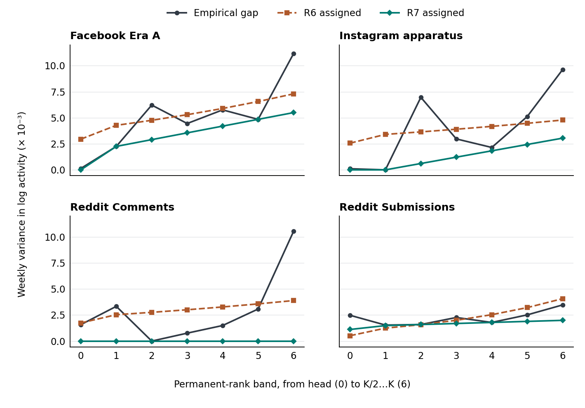

# Round 7 · Can a rank-specific jump budget improve the common model?

**Reject the bounded split as a replacement for Round 6.** The candidate repaired a measurable variance-allocation error and improved Facebook’s head statistics. The extra rank coefficient did not earn its cost across the four DEVELOPMENT panels. Submissions missed its prespecified turnover target and lost rolling-origin movement accuracy. The estimator also missed permanent jumps in every planted panel that contained both jumps and fading surges.

| S2 Gate v1 · lower is better | Staged R6 | R7 | Paired change ± split SD |
|---|---:|---:|---:|
| Facebook Era A | 0.089 | **0.083** | −0.006 ± 0.007 |
| Instagram apparatus | 0.306 | **0.282** | −0.024 ± 0.026 |
| Reddit Comments | **0.113** | 0.118 | +0.005 ± 0.042 |
| Reddit Submissions | **0.178** | 0.209 | +0.031 ± 0.021 |

Instagram’s gain came from switching jumps off on all five gate fits. Its largest favorable moment contribution was rank-1 collisions (−0.038 gate-error units), partly offset by persistence (+0.012). On Submissions the largest losses came from four- and thirteen-week displacement (+0.021 and +0.012). The eight arm–panel means stayed within the prespecified +0.05 tolerance relative to staged R6. That comparison convention alone does not establish an advantage. The tables below include all origins, arm comparisons and median-consistency rates.

For S3 the jump rule switched off on all four full panels and all 20 gate training windows. R7’s five per-origin S3 gate scores on each platform exactly match the adopted R4/source-R6 arm. Their means are 0.091, 0.304, 0.124 and 0.198. The staged R6 artifact has a different S3 comparator. Relative to it, several R7 means improve, but these gains cannot be attributed to successful coexistence of symmetric jumps and fading surges.

## Predictions checked against staged Round 6

1. **Head turnover and share · partial.** On Facebook S2, median top-10 turnover moved from 0.475 to 0.400 [0.298, 0.650] against observed 0.350, exceeding the predicted 0.05 reduction. The final K/64 share moved from 0.241 to 0.230 [0.205, 0.251] against observed 0.229. Submissions turnover rose from 0.150 to 0.167 [0.065, 0.267], short of the predicted +0.025 and still below observed 0.300. Its head share fell from 0.577 to 0.557 [0.515, 0.650], while observed share was 0.356. Brackets are 5th–95th percentiles across 20 seeds.
2. **Instagram movement and short-horizon score · pass.** S2 gate error fell by 0.024, more than the predicted 0.01. One-week X CRPS moved from 0.4726 to 0.4714, within the prespecified 0.005 change. The independent permanent-rank breakdown below shows why much of the endpoint error remains in the body.
3. **Reddit asymmetry and dispersion · pass on preservation, persistent calibration error.** Across the five Submissions horizons, R7 S2 coverage is 0.923–0.932 and S3 coverage is 0.936–0.952. The largest absolute S2 coverage change is below 0.004, as predicted. S3 retains positive D on Comments (0.149 [0.137, 0.170], observed 0.132) and Submissions (0.163 [0.136, 0.190], observed 0.222). Mean absolute differences between the ten simulated and empirical decile ordinates changed from 0.020 to 0.022 and from 0.032 to 0.032, inside the 0.03 guard. Instagram S3 still has the wrong sign (+0.082 [0.058, 0.106], empirical −0.087 [−0.122, −0.050]). As predicted, Submissions S2 coverage changed by less than 0.01 at every horizon. It remains 0.923–0.932. S3 coverage is 0.936–0.952 and PIT SD is 0.242–0.250.
4. **Structure and movement guardrails · partial.** All eight full-panel boundary changes were within 0.05 and departure-rate changes within 0.005. The gate guard also held on every panel and arm. Final S2 ladder-span error fell at all four scored ranks on Facebook but increased at 10 of the 12 ranks on the other panels. That is a structural cost even when top-10 turnover improves. On the frozen Submissions transfer the S2 boundary ratio improved against the observed 0.881 (1.025 → 1.003), while head share moved farther from observed 0.356 (0.566 → 0.591). On exact calendar dates the same head-share comparison moved slightly in the opposite direction. The different windows matter.

**Individual endpoints.** Across the 17 panel–horizon cells, S2 lowered X CRPS in 5 and log-rank CRPS in 5 against staged R6. Instagram accounted for three of the X improvements and Submissions for two. Both scores worsened at all five Comments horizons. Analytical Kalman MAE still beat the train-fitted EWMA in 15/17 cells for S2 and 16/17 for S3. At 52 weeks on Submissions, S2 head share-shift MAE improved from 942.5 to 918.4 parts per million of recorded top-K activity, but its correlation remained negative (−0.437 → −0.265). S3’s MAE improved from 855.6 to 837.8 and correlation from +0.754 to +0.805. Thus even a better absolute-error forecast can have the wrong ordering of who gains share. Five-origin paired spreads and fair head Brier scores appear in the panel tables.

**Development decision.** Keep the supplied R6 specification. The constrained jump budget belongs in this workspace as a diagnostic. The Facebook gain warrants recording, while the failures on Submissions movement, on Comments endpoint forecasting and on planted coexistence argue against either a default replacement or a platform-specific switch. The experiment provides no held-out confirmation. [Frozen gate](candidate_frozen_gate_results.json) · [Gold benchmark](candidate_gold_benchmark_results.json) · [Pre-run predictions and full log](EXPERIMENT_LOG.md)

## What changed

Round 6 used the passing-volatility rank slope to assign permanent jumps. In the first permanent-rank band, the estimated weekly variance gap was 0.00014 on Facebook and 0.00248 on Submissions. The supplied source assigned 0.00295 and 0.00051, respectively. The direction of error reverses. Instagram’s first two bands have almost no measured gap. The Comments gap is uneven across adjacent bands. These observations motivate testing a bounded rank profile and also make estimation from short training windows difficult.



*Figure 1.* The measured gap is the positive difference between the mean-square and robust central lasting estimates. Lines connect seven permanent-rank bands. R7 assigns zero throughout the full Comments panel because the fitted allocation falls below the activation threshold. Each panel in the figure is one full-sample fit. The gate refits the profile at each training origin.

Let $Q_A(L)=\sigma_0^2\exp[-2\beta\,\mathrm{clip}(L-L_K)]$ be the smooth **total** weekly lasting innovation variance in arm $A$. The bandwise mean-square structure-function fit estimates this total after accounting for passing activity, observation noise and, in S3, fading surges and persistent drift. The positive central variance estimate $c_b$ comes from the symmetric, jump-free IQR fit at lags 1–13, with persistence pinned by the full mean-square fit. The robust fit uses the simulator’s increment law and the existing three fixed-point updates. It is the same reference in both arms. If $q_{2b}$ and $q_{Ab}$ are their bandwise mean-square lasting variances, the available jump budget is

$$u_b=\max\{0,\min(q_{2b}-c_b,\ q_{Ab}-c_b,\ 0.85q_{Ab})\}.$$

Use the existing permanent-rank knots $z_b$ and octave weights $w_b=\min(n_b,100)$. Fit one line $\ell(z)=a+bz$ by minimizing $\sum_b w_b[u_b-\ell(z_b)]^2$ subject to $\ell(z_b)\le u_b$ at every knot. The fit compares the signed line to observed budgets. The allocation takes its positive part. Outside the first and last in-K knots, the line is held at the nearest endpoint. Missing estimates supply zero budget. Taking the positive part preserves the upper bound between knots under linear interpolation of the budgets. No empirical band values are carried into the simulator as fitted ordinates beyond those two coefficients.

For activation, take the weighted sum of allocated variance at the knots before the live-level cap and divide by the weighted sum of mean-square lasting variance, including the one-week surge and drift contributions in S3. If this fraction exceeds the existing 0.20 threshold, define $j(L,z)=\min([\ell(z)]_+,0.85Q_A(L))$. Otherwise $j=0$. At the benchmark’s fixed lasting-amplitude exponent $\gamma_L=0$, the model is

$$
\begin{aligned}
X_t &= L_t+\xi_t+s_t+\varepsilon_t,\\
L_{t+1} &= L_t+g(z_t)+d_t+\sqrt{Q_A(L_t)-j(L_t,z_t)}\,\eta_t
 + B_t\sqrt{j(L_t,z_t)/\lambda_J}\,Z_t .
\end{aligned}
$$

Here $\eta$ is the existing centered unit-variance innovation, $Z$ is independently standard Gaussian, and $B$ is Bernoulli with the inherited fixed event rate $\lambda_J=0.02$ per week. The two innovation terms sum in variance to $Q_A(L)$ at every level. Simulation applies the budget using latent lasting rank. Estimation and filtering use ranks estimated with absence penalties in the training window. The Atlas drift uses the smooth total once. The conditional-median volatility filter, Kalman process covariance and simulator use the same split. The optional nonzero lasting-amplitude exponent scales both components in this representation.

S2 sets surge and entity drift to zero. S3 retains the incumbent capped-exponential fading surge, its third- and fifth-cumulant estimates and its gapped-covariance drift estimate. The symmetric allocation rule uses the variance left after those components are fitted. A positive S3 estimate for either component alone does not establish its physical interpretation. There are no platform-name switches in the candidate.

### Parsimony and activation

Round 4 used 11 scalars for S2 on every full panel. The evaluated Round 5 S2 used 12 on every panel. Both rounds used 14/14/15/15 full-panel S3 coefficients.

The benchmark uses 11 core coefficients. An active jump profile adds two fitted ordinates, one more than the incumbent’s single jump coefficient. Its knot locations, rate, activation threshold and 15% diffusion floor are fixed conventions. The emitted scalar `jump_c` is derived from the larger fitted endpoint and event rate. S3 counts three coefficients for an active surge and one for positive persistent-drift variance. These counts follow the repository convention. They exclude measured inputs such as the starting ladder, empirical innovation quantiles, Facebook instrument, and numerically derived balancing drift. Two fitted ordinates are charged even when an inequality binds. No coefficient is estimated from a benchmark score.

| Panel | R6 staged S2 / S3 | R7 full S2 / S3 | R7 proposed share S2 / S3 | Gate training windows active S2 / S3 |
|---|---:|---:|---:|---:|
| Facebook | 12 / 15 | 13 / 14 | 31.1% / 14.2% | 1/5 / 0/5 |
| Instagram | 12 / 14 | 13 / 14 | 33.1% / 8.2% | 0/5 / 0/5 |
| Comments | 12 / 16 | 11 / 15 | 19.0% / 0.1% | 5/5 / 0/5 |
| Submissions | 12 / 15 | 13 / 15 | 28.8% / 0.0% | 5/5 / 0/5 |

The full Comments fit turns jumps off while every gate-origin Comments S2 fit turns them on. Instagram does the reverse. A full-panel variance diagram alone cannot explain the rolling-origin scores. The Gold endpoint fits use a different origin calendar. Only 1/20 S3 endpoint fits activated jumps, Instagram at 22 training weeks (allocated share 0.20094). Its fitted surge and persistent drift were both zero. No S3 full-panel, gate-origin or Gold endpoint-origin fit demonstrated joint activation of surges and lasting jumps. The existing filter and fixed-point refinement are held constant. [Gate-origin variance budgets](split_diagnostics.json) · [Gold S3 activations](gold_s3_activation.json)

### What the planted tests identified

The independent plant generated ranks by reordering simulated observations, with 180 weeks, 3,200 entities, K=1,600 and total lasting variance 0.018. At rate 0.02, the planted weekly jump variance ran from 0.0001 to 0.014 or in reverse. Seeds were 431, 853 and 1289. This is a test of finite-panel identification. The separate simulator and covariance tests check the exact accounting under known parameters.

| Plant | Result across all three seeds |
|---|---|
| Gaussian diffusion only | No activation. Proposed fractions 0.197, 0.042 and 0.002 show how close a finite null can come to the 0.20 threshold. |
| Jump variance increasing toward the body | Correct direction on 3/3. Estimated body variances 0.01092, 0.01016 and 0.00849 versus 0.014 planted. All three head estimates were zero. |
| Jump variance increasing toward the head | Correct direction on 0/3. Two fits switched off and one estimated a small gradient of the wrong sign. |
| Rising jump variance plus a fading surge | Recovered positive surge rates on 3/3 and the symmetric jump allocation on 0/3. Fitted surge half-lives were 26, 39 and 39 weeks versus 13 planted. |

An oracle calculation helped interpret the reversal test. Using the true planted variance of each training rank band, the capped-weight projection retained 19.96%, 20.05% and 19.97% of total variance for the falling gradient, compared with 54.0–54.5% for the rising one. The original falling plant sits at the switch threshold by construction of the weighted moment. In a post hoc sensitivity, adding 0.007 to both jump and total variance preserved the diffusive variance and slope while raising the oracle share to about 42%. One of three fits then activated with the correct direction. The candidate still has limited power for head-concentrated jumps even away from the cutoff. [Oracle and sensitivity results](planted_oracle.log)

The projection imposes simultaneous bounds on seven noisy estimates. A single small estimated budget can restrict neighboring ranks. Subtracting variance assigned to surges can also exhaust a real permanent-jump budget. These examples establish that both failure modes occur. They limit the interpretation of the zero S3 estimates on the four panels. [Recovery results](recovery_validation.json) · [Tests](test_common_rankdiff_astra_r7.py)

## Interpretation of the benchmark

The frozen Gate tests the distribution of survivor-conditional displacement and collision/persistence moments against the train-window historical-mobility baseline. The reported spread is the population SD across five overlapping origins. Its interval-consistency column counts origins where the simulated one-week median falls inside the empirical bootstrap interval. Gold’s activity coverage uses the second and thirty-eighth order statistics of 39 members for individual forecasts. Its calibrated reference is 36/40 = 0.900. Gold averages origin-level scores with a common cohort within each horizon. Its analytical point estimate propagates filtered components and omits future balancing drift. Head share in the structure tables means the arithmetic K/64 share within recorded top K. Forecast share-shift metrics score endpoints currently in the top K/16 at the origin, within the train-defined universe. Fair head Brier scores top-K/16 membership among endpoints currently in the top K/4. Turnover compares block memberships. Weekly rank-1 churn compares occupants. Immediate crossing means the departing entity is already observed below K at the next week. The terminal category includes right-censored 13-week returns.

The four anonymous caches supply development evidence. They were restricted to candidate entities using full-period information before this run. Within each origin, model moments and permanent ranks use only training weeks. The Facebook replication floor is also cached across the observation era. These features limit claims of prospective validation. Instagram measures a-matching activity under the §2z-c apparatus. The two available short panels support fewer Gold horizons. Results below include every available horizon and all five origins. The 20 simulated worlds provide dispersion conditional on the fitted panel. The 200-draw entity bootstrap for empirical asymmetry conditions on the observed calendar.

### Provenance of the comparators

The primary comparison uses the supplied `baseline_r6/` JSONs. Their S3 gate means are **0.095, 0.340, 0.177 and 0.201** in FB/IG/Comments/Submissions order. The brief quotes **0.091, 0.304, 0.124 and 0.198**. The latter match the adopted R4 variance-plus-median-filter arm. The supplied R6 **source** also uses that path when asymmetry is enabled. Its full-panel scalar counts are 14/14/15/15. The staged R6 evaluation and the source baseline therefore answer different attribution questions. Both are explicitly labeled. The R6 S2 gate means agree with the brief. [Staged Gate](baseline_r6/candidate_frozen_gate_results.json) · [Staged Gold](baseline_r6/candidate_gold_benchmark_results.json)

Round 4 uses the adopted Gate archive. Its S2 Gold is in the Astra archive. Adopted S3 uses the R3 unconditional simulation and the filter-only factorial arm for rolling endpoints and transfer. That factorial arm is labeled S2 by its two-slot evaluator. Round 5 uses Fable’s actual candidate output, including its experimental robust S3 arm. This preserves the distinction between evaluated arms and subsequent adoption decisions in MODEL_STATUS §2z-dy and §2z-dz. [Round 4 gate](../round4_baseline/candidate_frozen_gate_results.json) · [Round 4 factorial](../astra_v2/diag_ablation.json) · [Round 5 Gold](../fable_v2/candidate_gold_benchmark_results.json)

### Exact-calendar interpretation

Gold’s standard row-104 transfer starts its test on 2020-11-23 for Comments and 2020-11-30 for Submissions. A second run selected weekly labels 2019-01-07 through 2022-12-19, trained through 2020-12-28 and started forecasting on 2021-01-04. It used the same 20 seeds (7000–7019), equations, filter, and frozen structure statistics. With 103 test weeks, the frozen 52-week rule admits only one complete block. Its turnover is undefined and its first-to-last ladder change is mechanically zero. The calendar table instead includes turnover between the first 51 available weeks of each test year. The intervening week is simulated. Both comparator and candidate use those same dates, cohorts and rules. [Calendar results](calendar_transfer.json) · [Runner](calendar_transfer.py)

On those dates, S2’s median boundary ratio for Comments moves from 1.005 to 1.000 (observed 0.945) and for Submissions from 1.017 to 1.001 (observed 0.891). Comments’ departure rate moves away from the data, from 0.0092 to 0.0133 (observed 0.0067), while its immediate crossing fraction moves closer, from 0.921 to 0.939 (observed 0.949). The median top-10 turnover is unchanged on both panels in both arms. S3’s full exact-calendar simulations reproduce the supplied-source R6 comparator on these measures. The seed bands appear in the calendar table below.

### Where the endpoint-calibration errors occur

The independent stratified forecast run reused Gold’s S2 conditional draws and five origins. “Head” means ranks 1…K/16 by training permanent rank, “middle” ends at K/2, and “outer” ends at K. Each loss or tail probability is an equal-weight mean of origin means. This diagnostic localizes the discrepancies. The observational data do not identify a unique variance component responsible for them.

On Instagram at one week the R7 outer half still has X CRPS about 0.519 and coverage about 0.884, compared with 0.315 and 0.906 at the head. The small improvement in overall CRPS is carried by the much larger body cohort. At 52 weeks on Submissions only about 1.2% of head and 1.8% of middle outcomes exceed the upper order statistic, against an exchangeable reference of 5%. Low-tail misses in the outer half reach 5.5%. A global reduction in interval width would treat those tails and ranks alike. The higher head variance allocation alone leaves the main calibration discrepancy in place. [All origins, horizons, widths and errors](forecast_strata.json)

| Panel | h | Rank band | R6 CRPS | R6 cov. | R6 below / above | R7 CRPS | R7 cov. | R7 below / above |
| --- | --- | --- | --- | --- | --- | --- | --- | --- |
| Instagram apparatus | 1 | head | 0.3148 | 0.911 | 0.036 / 0.053 | 0.3151 | 0.906 | 0.039 / 0.055 |
| Instagram apparatus | 1 | middle | 0.4452 | 0.894 | 0.047 / 0.059 | 0.4436 | 0.894 | 0.048 / 0.058 |
| Instagram apparatus | 1 | outer | 0.5200 | 0.886 | 0.052 / 0.063 | 0.5188 | 0.883 | 0.054 / 0.062 |
| Instagram apparatus | 13 | head | 0.4493 | 0.881 | 0.049 / 0.069 | 0.4465 | 0.881 | 0.051 / 0.067 |
| Instagram apparatus | 13 | middle | 0.5759 | 0.890 | 0.049 / 0.061 | 0.5709 | 0.888 | 0.051 / 0.061 |
| Instagram apparatus | 13 | outer | 0.6242 | 0.888 | 0.054 / 0.059 | 0.6227 | 0.885 | 0.056 / 0.059 |
| Reddit Submissions | 1 | head | 0.0814 | 0.933 | 0.030 / 0.037 | 0.0815 | 0.932 | 0.032 / 0.036 |
| Reddit Submissions | 1 | middle | 0.1093 | 0.925 | 0.035 / 0.040 | 0.1093 | 0.925 | 0.036 / 0.039 |
| Reddit Submissions | 1 | outer | 0.1420 | 0.919 | 0.042 / 0.039 | 0.1419 | 0.919 | 0.042 / 0.039 |
| Reddit Submissions | 13 | head | 0.1680 | 0.944 | 0.035 / 0.021 | 0.1691 | 0.945 | 0.033 / 0.022 |
| Reddit Submissions | 13 | middle | 0.1936 | 0.943 | 0.029 / 0.028 | 0.1941 | 0.942 | 0.029 / 0.029 |
| Reddit Submissions | 13 | outer | 0.2449 | 0.925 | 0.038 / 0.038 | 0.2450 | 0.922 | 0.040 / 0.039 |
| Reddit Submissions | 52 | head | 0.3204 | 0.939 | 0.050 / 0.011 | 0.3201 | 0.946 | 0.043 / 0.012 |
| Reddit Submissions | 52 | middle | 0.3463 | 0.946 | 0.035 / 0.019 | 0.3464 | 0.945 | 0.036 / 0.018 |
| Reddit Submissions | 52 | outer | 0.4186 | 0.920 | 0.049 / 0.030 | 0.4176 | 0.914 | 0.055 / 0.031 |

### Reproduction and verification

Run from this workspace with the registered Python 3.11 interpreter. The launcher wraps the exact benchmark and confines its lock, temporary directory and Python/plot caches here. It resumes at Gold if the complete Gate JSON already exists. The diagnostics, test suite and calendar supplement use the same registered interpreter. The repo-wide legacy health check requires a raw panel outside the scope of this task. The targeted suite passed **30/30**. With `scale_moment="meta"`, a separate compatibility check reproduced the starting module’s fitted parameters, filtered states and simulated observations, ranks and identities on two planted panels. The Gaussian oracle reproduced coverage 0.89855 and PIT SD 0.28951. The archive checks matched frozen empirical inputs, common cohorts, historical baselines, calibration-interval and CRPS recomputations, and the 104/103-week separate calendar design. [Test log](candidate_tests.log) · [Compatibility check](compatibility_check.log) · [Experiment log](EXPERIMENT_LOG.md)

```bash
py=/Library/Frameworks/Python.framework/Versions/3.11/bin/python3
export PYTHONDONTWRITEBYTECODE=1 TMPDIR="$PWD/.runtime/tmp"
export XDG_CACHE_HOME="$PWD/.runtime/cache" MPLCONFIGDIR="$PWD/.runtime/cache"
export OPENBLAS_NUM_THREADS=1 VECLIB_MAXIMUM_THREADS=1 OMP_NUM_THREADS=1
mkdir -p "$TMPDIR" "$XDG_CACHE_HOME"
bash run_benchmark.sh
"$py" -m pytest -q -p no:cacheprovider test_common_rankdiff_astra_r7.py
"$py" -u diagnose_split.py
"$py" -u recovery_validation.py
"$py" -u calendar_transfer.py
"$py" compare_rounds.py
```

## Gate v1 across four rounds

| Panel | Arm | Historical | R4 | R5 | Staged R6 | R7 | Paired Δ ± SD | R7 < R6 / 5 | R7 median in CI | R7 < historical |
| --- | --- | --- | --- | --- | --- | --- | --- | --- | --- | --- |
| Facebook Era A | S2 | 0.147 | 0.084 ± 0.037 | 0.093 ± 0.031 | 0.089 ± 0.037 | 0.083 ± 0.038 | -0.006 ± 0.007 | 4 | 80% | 4/5 |
| Facebook Era A | S3 | 0.147 | 0.091 ± 0.016 | 0.107 ± 0.032 | 0.095 ± 0.018 | 0.091 ± 0.016 | -0.005 ± 0.014 | 2 | 80% | 5/5 |
| Instagram apparatus | S2 | 0.869 | 0.282 ± 0.219 | 0.344 ± 0.216 | 0.306 ± 0.232 | 0.282 ± 0.219 | -0.024 ± 0.026 | 3 | 80% | 4/5 |
| Instagram apparatus | S3 | 0.869 | 0.304 ± 0.230 | 0.274 ± 0.229 | 0.340 ± 0.248 | 0.304 ± 0.230 | -0.036 ± 0.048 | 4 | 80% | 4/5 |
| Reddit Comments | S2 | 0.158 | 0.134 ± 0.085 | 0.096 ± 0.028 | 0.113 ± 0.035 | 0.118 ± 0.062 | +0.005 ± 0.042 | 4 | 80% | 4/5 |
| Reddit Comments | S3 | 0.158 | 0.124 ± 0.057 | 0.130 ± 0.057 | 0.177 ± 0.110 | 0.124 ± 0.057 | -0.053 ± 0.080 | 3 | 100% | 4/5 |
| Reddit Submissions | S2 | 0.165 | 0.263 ± 0.067 | 0.196 ± 0.103 | 0.178 ± 0.066 | 0.209 ± 0.068 | +0.031 ± 0.021 | 1 | 80% | 2/5 |
| Reddit Submissions | S3 | 0.165 | 0.198 ± 0.079 | 0.266 ± 0.241 | 0.201 ± 0.069 | 0.198 ± 0.079 | -0.002 ± 0.032 | 1 | 100% | 3/5 |

Average contributions to the paired gate change, with the frozen per-split denominator.

| Panel | Arm | Δrank 1w | Δrank 4w | Δrank 13w | RACF1 | Coll. 1 | Coll. 5 | Coll. 20 | Total |
| --- | --- | --- | --- | --- | --- | --- | --- | --- | --- |
| Facebook Era A | S2 | +0.002 | +0.003 | -0.000 | -0.002 | -0.006 | -0.003 | +0.001 | -0.006 |
| Facebook Era A | S3 | -0.002 | +0.000 | +0.002 | -0.002 | -0.003 | +0.001 | -0.000 | -0.005 |
| Instagram apparatus | S2 | +0.003 | -0.004 | — | +0.012 | -0.038 | +0.003 | +0.001 | -0.024 |
| Instagram apparatus | S3 | +0.005 | -0.002 | — | +0.011 | -0.050 | +0.001 | -0.001 | -0.036 |
| Reddit Comments | S2 | +0.005 | +0.004 | -0.003 | -0.003 | +0.004 | -0.000 | -0.002 | +0.005 |
| Reddit Comments | S3 | +0.000 | +0.000 | -0.005 | -0.001 | -0.040 | -0.005 | -0.002 | -0.053 |
| Reddit Submissions | S2 | +0.000 | +0.021 | +0.012 | +0.003 | -0.005 | -0.001 | +0.001 | +0.031 |
| Reddit Submissions | S3 | -0.011 | +0.007 | +0.005 | +0.000 | +0.000 | -0.003 | -0.000 | -0.002 |

## Exact-calendar Reddit transfer

| Panel | Measure | Calendar test | R6 source S2 | R7 S2 | R6 source S3 | R7 S3 |
| --- | --- | --- | --- | --- | --- | --- |
| Reddit Comments | Matched top-10 turnover | 0.300 | 0.300 [0.100, 0.305] | 0.300 [0.100, 0.405] | 0.400 [0.295, 0.505] | 0.400 [0.295, 0.505] |
| Reddit Comments | Matched K/4 turnover | 0.154 | 0.143 [0.138, 0.148] | 0.137 [0.132, 0.144] | 0.141 [0.134, 0.149] | 0.141 [0.134, 0.149] |
| Reddit Comments | Weekly rank-1 change | 0.029 | 0.029 [0.000, 0.187] | 0.000 [0.000, 0.151] | 0.162 [0.019, 0.324] | 0.162 [0.019, 0.324] |
| Reddit Comments | K/64 share in top K | 0.506 | 0.555 [0.516, 0.588] | 0.554 [0.514, 0.586] | 0.598 [0.554, 0.690] | 0.598 [0.554, 0.690] |
| Reddit Comments | Boundary ratio | 0.945 | 1.005 [0.991, 1.020] | 1.000 [0.985, 1.007] | 1.198 [1.155, 1.233] | 1.198 [1.155, 1.233] |
| Reddit Comments | Weekly departure rate | 0.007 | 0.009 [0.009, 0.010] | 0.013 [0.012, 0.014] | 0.010 [0.009, 0.010] | 0.010 [0.009, 0.010] |
| Reddit Comments | Immediate crossing fraction | 0.950 | 0.921 [0.911, 0.927] | 0.939 [0.933, 0.946] | 0.907 [0.895, 0.913] | 0.907 [0.895, 0.913] |
| Reddit Comments | Absent then observed within 13w | 0.021 | 0.077 [0.071, 0.086] | 0.059 [0.053, 0.064] | 0.092 [0.085, 0.104] | 0.092 [0.085, 0.104] |
| Reddit Comments | Absent, no 13w return seen | 0.030 | 0.002 [0.001, 0.004] | 0.001 [0.000, 0.003] | 0.002 [0.001, 0.003] | 0.002 [0.001, 0.003] |
| Reddit Comments | Gapped ρ | 0.114 | -0.043 [-0.050, -0.033] | -0.042 [-0.051, -0.039] | 0.005 [-0.003, 0.013] | 0.005 [-0.003, 0.013] |
| Reddit Comments | D | 0.117 | -0.031 [-0.061, -0.013] | -0.048 [-0.067, -0.030] | 0.047 [0.021, 0.070] | 0.047 [0.021, 0.070] |
| Reddit Comments | Faller persistence | 0.155 | -0.065 [-0.080, -0.042] | -0.073 [-0.083, -0.065] | -0.013 [-0.030, 0.005] | -0.013 [-0.030, 0.005] |
| Reddit Comments | Riser persistence | 0.038 | -0.031 [-0.047, -0.015] | -0.025 [-0.038, -0.011] | -0.056 [-0.074, -0.042] | -0.056 [-0.074, -0.042] |
| Reddit Comments | Final ladder span at 1 | 10.272 | 9.979 [9.554, 10.931] | 10.572 [9.613, 11.122] | 10.295 [9.662, 12.104] | 10.295 [9.662, 12.104] |
| Reddit Comments | Final ladder span at K/64 | 6.098 | 5.798 [5.749, 5.860] | 5.788 [5.758, 5.850] | 5.932 [5.858, 6.045] | 5.932 [5.858, 6.045] |
| Reddit Comments | Final ladder span at K/16 | 4.681 | 4.421 [4.386, 4.448] | 4.420 [4.385, 4.451] | 4.473 [4.429, 4.516] | 4.473 [4.429, 4.516] |
| Reddit Comments | Final ladder span at K/4 | 2.812 | 2.472 [2.451, 2.492] | 2.361 [2.334, 2.391] | 2.485 [2.468, 2.525] | 2.485 [2.468, 2.525] |
| Reddit Submissions | Matched top-10 turnover | 0.300 | 0.200 [0.095, 0.400] | 0.200 [0.100, 0.305] | 0.300 [0.100, 0.500] | 0.300 [0.100, 0.500] |
| Reddit Submissions | Matched K/4 turnover | 0.151 | 0.181 [0.169, 0.190] | 0.173 [0.163, 0.183] | 0.202 [0.193, 0.213] | 0.202 [0.193, 0.213] |
| Reddit Submissions | Weekly rank-1 change | 0.039 | 0.000 [0.000, 0.050] | 0.000 [0.000, 0.100] | 0.005 [0.000, 0.099] | 0.005 [0.000, 0.099] |
| Reddit Submissions | K/64 share in top K | 0.356 | 0.542 [0.501, 0.636] | 0.539 [0.488, 0.596] | 0.469 [0.425, 0.516] | 0.469 [0.425, 0.516] |
| Reddit Submissions | Boundary ratio | 0.891 | 1.017 [0.998, 1.040] | 1.001 [0.977, 1.019] | 1.289 [1.224, 1.313] | 1.289 [1.224, 1.313] |
| Reddit Submissions | Weekly departure rate | 0.005 | 0.010 [0.009, 0.010] | 0.008 [0.007, 0.009] | 0.007 [0.006, 0.008] | 0.007 [0.006, 0.008] |
| Reddit Submissions | Immediate crossing fraction | 0.946 | 0.984 [0.978, 0.990] | 0.985 [0.976, 0.988] | 0.975 [0.966, 0.985] | 0.975 [0.966, 0.985] |
| Reddit Submissions | Absent then observed within 13w | 0.029 | 0.016 [0.010, 0.021] | 0.014 [0.011, 0.024] | 0.025 [0.015, 0.033] | 0.025 [0.015, 0.033] |
| Reddit Submissions | Absent, no 13w return seen | 0.025 | 0.000 [0.000, 0.002] | 0.000 [0.000, 0.002] | 0.000 [0.000, 0.002] | 0.000 [0.000, 0.002] |
| Reddit Submissions | Gapped ρ | 0.096 | -0.027 [-0.044, -0.016] | -0.023 [-0.035, -0.006] | 0.059 [0.046, 0.073] | 0.059 [0.046, 0.073] |
| Reddit Submissions | D | 0.146 | -0.034 [-0.063, -0.011] | -0.039 [-0.060, -0.011] | 0.155 [0.132, 0.172] | 0.155 [0.132, 0.172] |
| Reddit Submissions | Faller persistence | 0.164 | -0.046 [-0.071, -0.033] | -0.042 [-0.064, -0.022] | 0.086 [0.068, 0.107] | 0.086 [0.068, 0.107] |
| Reddit Submissions | Riser persistence | 0.018 | -0.015 [-0.031, 0.014] | -0.008 [-0.025, 0.019] | -0.062 [-0.084, -0.051] | -0.062 [-0.084, -0.051] |
| Reddit Submissions | Final ladder span at 1 | 7.062 | 9.248 [8.394, 10.248] | 9.113 [8.253, 10.088] | 8.647 [7.929, 9.373] | 8.647 [7.929, 9.373] |
| Reddit Submissions | Final ladder span at K/64 | 4.701 | 4.758 [4.625, 4.834] | 4.737 [4.654, 4.838] | 4.876 [4.783, 4.984] | 4.876 [4.783, 4.984] |
| Reddit Submissions | Final ladder span at K/16 | 3.433 | 3.466 [3.375, 3.498] | 3.458 [3.403, 3.528] | 3.577 [3.509, 3.617] | 3.577 [3.509, 3.617] |
| Reddit Submissions | Final ladder span at K/4 | 2.058 | 1.914 [1.889, 1.952] | 1.910 [1.862, 1.954] | 2.025 [1.978, 2.063] | 2.025 [1.978, 2.063] |

## Full results by panel

Each panel contains both arms at every available horizon. Open a panel for the four-round comparison.

<details>
<summary><strong>Facebook Era A</strong> · structure, hooks, endpoint scores and paired changes</summary>

Full-panel structure. Entries for R6 and R7 give the seed median and its 5th–95th percentile band. The earlier rounds show the median. The empirical intervals on ρ and D are entity-cluster bootstrap intervals.

**S2 structure**

| Measure | Observed | R4 | R5 | Staged R6 | R7 |
| --- | --- | --- | --- | --- | --- |
| Top-10 turnover | 0.350 | 0.350 | 0.450 | 0.475 [0.348, 0.600] | 0.400 [0.298, 0.650] |
| K/4 turnover | 0.237 | 0.212 | 0.205 | 0.218 [0.207, 0.228] | 0.207 [0.198, 0.218] |
| Weekly rank-1 change | 0.518 | 0.459 | 0.506 | 0.482 [0.262, 0.625] | 0.635 [0.552, 0.825] |
| K/64 share in top K | 0.229 | 0.242 | 0.242 | 0.241 [0.217, 0.275] | 0.230 [0.205, 0.251] |
| Boundary ratio | 0.980 | 0.998 | 1.069 | 1.015 [1.001, 1.037] | 1.007 [0.983, 1.032] |
| Weekly departure rate | 0.033 | 0.044 | 0.035 | 0.044 [0.041, 0.045] | 0.046 [0.043, 0.047] |
| Immediate crossing fraction | 0.957 | 0.954 | 0.937 | 0.953 [0.945, 0.960] | 0.956 [0.946, 0.961] |
| Absent then observed within 13w | 0.037 | 0.045 | 0.061 | 0.046 [0.039, 0.054] | 0.043 [0.038, 0.052] |
| Absent, no 13w return seen | 0.005 | 0.001 | 0.001 | 0.001 [0.000, 0.002] | 0.001 [0.001, 0.002] |
| Gapped ρ | -0.095 [-0.112, -0.080] | -0.068 | -0.068 | -0.072 [-0.082, -0.057] | -0.066 [-0.082, -0.058] |
| D | 0.031 [-0.013, 0.079] | -0.027 | -0.034 | -0.021 [-0.054, 0.007] | -0.031 [-0.054, -0.012] |
| Faller persistence | -0.111 | -0.092 | -0.094 | -0.087 [-0.111, -0.062] | -0.086 [-0.115, -0.073] |
| Riser persistence | -0.142 | -0.062 | -0.061 | -0.067 [-0.087, -0.038] | -0.061 [-0.073, -0.041] |
| Final ladder span at 1 | 5.762 | 6.123 | 5.812 | 6.062 [5.561, 7.027] | 5.505 [5.255, 5.787] |
| Change in ladder span at 1 | -0.233 | -0.046 | -0.172 | 0.059 [-0.365, 1.100] | -0.257 [-0.602, 0.034] |
| Final ladder span at K/64 | 4.003 | 3.960 | 4.005 | 3.968 [3.837, 4.096] | 3.988 [3.865, 4.066] |
| Change in ladder span at K/64 | -0.033 | -0.022 | 0.044 | 0.015 [-0.117, 0.123] | 0.044 [-0.087, 0.121] |
| Final ladder span at K/16 | 2.979 | 2.940 | 2.945 | 2.900 [2.839, 2.982] | 2.925 [2.834, 2.951] |
| Change in ladder span at K/16 | 0.064 | 0.000 | 0.028 | 0.020 [-0.042, 0.102] | 0.048 [-0.032, 0.083] |
| Final ladder span at K/4 | 1.671 | 1.709 | 1.681 | 1.681 [1.625, 1.721] | 1.677 [1.643, 1.716] |
| Change in ladder span at K/4 | -0.013 | 0.009 | 0.006 | 0.019 [-0.058, 0.054] | 0.009 [-0.035, 0.025] |

**S3 structure**

| Measure | Observed | R4 | R5 | Staged R6 | R7 |
| --- | --- | --- | --- | --- | --- |
| Top-10 turnover | 0.350 | 0.550 | 0.600 | 0.550 [0.348, 0.800] | 0.550 [0.400, 0.650] |
| K/4 turnover | 0.237 | 0.223 | 0.185 | 0.229 [0.215, 0.239] | 0.223 [0.214, 0.237] |
| Weekly rank-1 change | 0.518 | 0.435 | 0.406 | 0.453 [0.282, 0.642] | 0.435 [0.244, 0.730] |
| K/64 share in top K | 0.229 | 0.290 | 0.296 | 0.313 [0.257, 0.399] | 0.290 [0.239, 0.350] |
| Boundary ratio | 0.980 | 1.137 | 1.178 | 1.170 [1.136, 1.204] | 1.137 [1.077, 1.179] |
| Weekly departure rate | 0.033 | 0.044 | 0.024 | 0.044 [0.042, 0.046] | 0.044 [0.042, 0.046] |
| Immediate crossing fraction | 0.957 | 0.944 | 0.903 | 0.944 [0.938, 0.951] | 0.944 [0.936, 0.949] |
| Absent then observed within 13w | 0.037 | 0.054 | 0.094 | 0.055 [0.049, 0.060] | 0.054 [0.048, 0.062] |
| Absent, no 13w return seen | 0.005 | 0.002 | 0.003 | 0.002 [0.001, 0.002] | 0.002 [0.001, 0.003] |
| Gapped ρ | -0.095 [-0.112, -0.080] | -0.067 | -0.083 | -0.072 [-0.085, -0.060] | -0.067 [-0.079, -0.054] |
| D | 0.031 [-0.013, 0.079] | 0.044 | 0.080 | 0.040 [0.013, 0.069] | 0.044 [0.003, 0.072] |
| Faller persistence | -0.111 | -0.053 | -0.049 | -0.058 [-0.082, -0.037] | -0.053 [-0.087, -0.040] |
| Riser persistence | -0.142 | -0.104 | -0.133 | -0.097 [-0.116, -0.079] | -0.104 [-0.124, -0.077] |
| Final ladder span at 1 | 5.762 | 6.617 | 6.468 | 6.617 [5.794, 7.196] | 6.617 [5.743, 7.237] |
| Change in ladder span at 1 | -0.233 | 0.029 | -0.031 | 0.372 [-0.702, 0.845] | 0.029 [-1.872, 1.027] |
| Final ladder span at K/64 | 4.003 | 4.080 | 4.067 | 4.030 [3.899, 4.144] | 4.080 [3.911, 4.130] |
| Change in ladder span at K/64 | -0.033 | -0.028 | -0.009 | -0.044 [-0.136, 0.136] | -0.028 [-0.139, 0.174] |
| Final ladder span at K/16 | 2.979 | 2.959 | 2.931 | 2.850 [2.785, 2.939] | 2.959 [2.903, 3.005] |
| Change in ladder span at K/16 | 0.064 | 0.049 | 0.017 | -0.026 [-0.103, 0.074] | 0.049 [-0.018, 0.109] |
| Final ladder span at K/4 | 1.671 | 1.708 | 1.694 | 1.712 [1.654, 1.750] | 1.708 [1.665, 1.743] |
| Change in ladder span at K/4 | -0.013 | 0.008 | 0.013 | 0.000 [-0.062, 0.046] | 0.008 [-0.044, 0.062] |

**Ten-decile hook**

Cells give the mean next-window change by decile of prior change, summarized by the median across simulated worlds.

| Curve | 1 | 2 | 3 | 4 | 5 | 6 | 7 | 8 | 9 | 10 |
| --- | --- | --- | --- | --- | --- | --- | --- | --- | --- | --- |
| Observed | 0.164 | 0.058 | 0.072 | 0.059 | 0.003 | 0.015 | -0.033 | -0.020 | -0.068 | -0.251 |
| R4 S2 | 0.135 | 0.064 | 0.031 | 0.012 | -0.005 | -0.018 | -0.030 | -0.038 | -0.058 | -0.092 |
| R5 S2 | 0.125 | 0.052 | 0.030 | 0.007 | 0.006 | -0.008 | -0.020 | -0.043 | -0.051 | -0.098 |
| R6 S2 | 0.125 | 0.058 | 0.045 | 0.015 | 0.001 | -0.024 | -0.020 | -0.037 | -0.047 | -0.105 |
| R7 S2 | 0.124 | 0.062 | 0.042 | 0.010 | -0.004 | -0.018 | -0.024 | -0.041 | -0.062 | -0.092 |
| R7 S2 5% | 0.104 | 0.033 | 0.015 | -0.009 | -0.043 | -0.050 | -0.049 | -0.056 | -0.095 | -0.112 |
| R7 S2 95% | 0.168 | 0.089 | 0.060 | 0.028 | 0.016 | 0.007 | 0.001 | -0.019 | -0.023 | -0.061 |
| R4 S3 | 0.078 | 0.052 | 0.032 | 0.020 | 0.019 | 0.003 | 0.002 | -0.025 | -0.033 | -0.172 |
| R5 S3 | 0.060 | 0.057 | 0.050 | 0.024 | 0.026 | 0.011 | 0.008 | -0.020 | -0.047 | -0.191 |
| R6 S3 | 0.083 | 0.055 | 0.053 | 0.033 | 0.013 | 0.004 | -0.010 | -0.030 | -0.054 | -0.163 |
| R7 S3 | 0.078 | 0.052 | 0.032 | 0.020 | 0.019 | 0.003 | 0.002 | -0.025 | -0.033 | -0.172 |
| R7 S3 5% | 0.058 | 0.016 | 0.006 | 0.004 | -0.015 | -0.013 | -0.034 | -0.043 | -0.056 | -0.210 |
| R7 S3 95% | 0.127 | 0.093 | 0.061 | 0.058 | 0.042 | 0.020 | 0.026 | 0.028 | -0.007 | -0.121 |

**S2 endpoint scores**

| h (weeks) | Round | X CRPS | Kalman MAE | EWMA MAE | 90% coverage | PIT SD | logR CRPS | Fair head Brier | Head Δshare MAE ×10⁶ | Head Δshare corr. |
| --- | --- | --- | --- | --- | --- | --- | --- | --- | --- | --- |
| 1 | R4 | 0.2987 | 0.4026 | 0.4078 | 0.8834 | 0.2871 | 0.1969 | 0.0713 | 570.1 | 0.592 |
| 1 | R5 | 0.2984 | 0.4020 | 0.4078 | 0.8654 | 0.2963 | 0.1972 | 0.0707 | 570.6 | 0.565 |
| 1 | R6 | 0.2987 | 0.4026 | 0.4078 | 0.8824 | 0.2880 | 0.1968 | 0.0711 | 567.2 | 0.576 |
| 1 | R7 | 0.2987 | 0.4026 | 0.4078 | 0.8834 | 0.2871 | 0.1969 | 0.0713 | 570.1 | 0.592 |
| 4 | R4 | 0.3430 | 0.4659 | 0.4752 | 0.8937 | 0.2801 | 0.2308 | 0.0871 | 652.7 | 0.631 |
| 4 | R5 | 0.3422 | 0.4655 | 0.4752 | 0.8801 | 0.2898 | 0.2309 | 0.0876 | 652.7 | 0.637 |
| 4 | R6 | 0.3419 | 0.4655 | 0.4752 | 0.8910 | 0.2818 | 0.2304 | 0.0863 | 648.2 | 0.630 |
| 4 | R7 | 0.3430 | 0.4659 | 0.4752 | 0.8937 | 0.2801 | 0.2308 | 0.0871 | 652.7 | 0.631 |
| 13 | R4 | 0.4301 | 0.5804 | 0.6026 | 0.8956 | 0.2744 | 0.2711 | 0.0969 | 797.8 | 0.630 |
| 13 | R5 | 0.4279 | 0.5797 | 0.6026 | 0.8776 | 0.2860 | 0.2701 | 0.0966 | 781.1 | 0.647 |
| 13 | R6 | 0.4297 | 0.5800 | 0.6026 | 0.8913 | 0.2778 | 0.2713 | 0.0978 | 813.1 | 0.624 |
| 13 | R7 | 0.4301 | 0.5804 | 0.6026 | 0.8956 | 0.2744 | 0.2711 | 0.0969 | 797.8 | 0.630 |
| 26 | R4 | 0.5127 | 0.6968 | 0.7214 | 0.8948 | 0.2761 | 0.3069 | 0.1060 | 895.9 | 0.545 |
| 26 | R5 | 0.5106 | 0.6956 | 0.7214 | 0.8729 | 0.2907 | 0.3062 | 0.1047 | 882.0 | 0.570 |
| 26 | R6 | 0.5119 | 0.6965 | 0.7214 | 0.8903 | 0.2791 | 0.3071 | 0.1065 | 897.1 | 0.546 |
| 26 | R7 | 0.5127 | 0.6968 | 0.7214 | 0.8948 | 0.2761 | 0.3069 | 0.1060 | 895.9 | 0.545 |

**S3 endpoint scores**

| h (weeks) | Round | X CRPS | Kalman MAE | EWMA MAE | 90% coverage | PIT SD | logR CRPS | Fair head Brier | Head Δshare MAE ×10⁶ | Head Δshare corr. |
| --- | --- | --- | --- | --- | --- | --- | --- | --- | --- | --- |
| 1 | R4 | 0.2994 | 0.4022 | 0.4078 | 0.9037 | 0.2756 | 0.1967 | 0.0706 | 577.5 | 0.570 |
| 1 | R5 | 0.2989 | 0.4018 | 0.4078 | 0.8894 | 0.2834 | 0.1967 | 0.0707 | 571.5 | 0.577 |
| 1 | R6 | 0.2994 | 0.4022 | 0.4078 | 0.9037 | 0.2756 | 0.1967 | 0.0706 | 577.5 | 0.570 |
| 1 | R7 | 0.2994 | 0.4022 | 0.4078 | 0.9037 | 0.2756 | 0.1967 | 0.0706 | 577.5 | 0.570 |
| 4 | R4 | 0.3424 | 0.4659 | 0.4752 | 0.9057 | 0.2754 | 0.2303 | 0.0880 | 657.0 | 0.620 |
| 4 | R5 | 0.3418 | 0.4660 | 0.4752 | 0.8926 | 0.2824 | 0.2304 | 0.0884 | 661.9 | 0.623 |
| 4 | R6 | 0.3424 | 0.4659 | 0.4752 | 0.9057 | 0.2754 | 0.2303 | 0.0880 | 657.0 | 0.620 |
| 4 | R7 | 0.3424 | 0.4659 | 0.4752 | 0.9057 | 0.2754 | 0.2303 | 0.0880 | 657.0 | 0.620 |
| 13 | R4 | 0.4295 | 0.5801 | 0.6026 | 0.9010 | 0.2751 | 0.2714 | 0.0986 | 844.6 | 0.607 |
| 13 | R5 | 0.4288 | 0.5807 | 0.6026 | 0.8869 | 0.2829 | 0.2712 | 0.0980 | 858.2 | 0.603 |
| 13 | R6 | 0.4295 | 0.5801 | 0.6026 | 0.9010 | 0.2751 | 0.2714 | 0.0986 | 844.6 | 0.607 |
| 13 | R7 | 0.4295 | 0.5801 | 0.6026 | 0.9010 | 0.2751 | 0.2714 | 0.0986 | 844.6 | 0.607 |
| 26 | R4 | 0.5131 | 0.6949 | 0.7214 | 0.8972 | 0.2778 | 0.3083 | 0.1054 | 948.4 | 0.538 |
| 26 | R5 | 0.5091 | 0.6950 | 0.7214 | 0.8833 | 0.2856 | 0.3060 | 0.1049 | 947.1 | 0.534 |
| 26 | R6 | 0.5131 | 0.6949 | 0.7214 | 0.8972 | 0.2779 | 0.3083 | 0.1054 | 948.4 | 0.538 |
| 26 | R7 | 0.5131 | 0.6949 | 0.7214 | 0.8972 | 0.2779 | 0.3083 | 0.1054 | 948.4 | 0.538 |

**Paired endpoint changes against staged R6**

Mean R7 minus R6, between-origin SD and number of origins with lower R7 loss. The five overlapping origins give descriptive spread.

| h (weeks) | Arm | X CRPS | logR CRPS | Head Δshare MAE ×10⁶ |
| --- | --- | --- | --- | --- |
| 1 | S2 | +0.0000 ± 0.0009 (2/5) | +0.0001 ± 0.0008 (2/5) | +2.9 ± 8.4 (1/5) |
| 1 | S3 | +0.0000 ± 0.0000 (0/5) | +0.0000 ± 0.0000 (0/5) | +0.0 ± 0.0 (0/5) |
| 4 | S2 | +0.0011 ± 0.0007 (0/5) | +0.0004 ± 0.0003 (0/5) | +4.5 ± 8.8 (1/5) |
| 4 | S3 | +0.0000 ± 0.0000 (0/5) | +0.0000 ± 0.0000 (0/5) | +0.0 ± 0.0 (0/5) |
| 13 | S2 | +0.0004 ± 0.0018 (1/5) | -0.0002 ± 0.0005 (2/5) | -15.3 ± 14.2 (4/5) |
| 13 | S3 | +0.0000 ± 0.0000 (0/5) | +0.0000 ± 0.0000 (0/5) | +0.0 ± 0.0 (0/5) |
| 26 | S2 | +0.0008 ± 0.0027 (1/5) | -0.0002 ± 0.0015 (2/5) | -1.2 ± 23.0 (1/5) |
| 26 | S3 | +0.0000 ± 0.0000 (0/5) | +0.0000 ± 0.0000 (0/5) | +0.0 ± 0.0 (0/5) |

</details>

<details>
<summary><strong>Instagram apparatus</strong> · structure, hooks, endpoint scores and paired changes</summary>

Full-panel structure. Entries for R6 and R7 give the seed median and its 5th–95th percentile band. The earlier rounds show the median. The empirical intervals on ρ and D are entity-cluster bootstrap intervals.

**S2 structure**

| Measure | Observed | R4 | R5 | Staged R6 | R7 |
| --- | --- | --- | --- | --- | --- |
| Top-10 turnover | 0.267 | 0.167 | 0.200 | 0.200 [0.133, 0.302] | 0.167 [0.132, 0.300] |
| K/4 turnover | 0.295 | 0.223 | 0.229 | 0.221 [0.215, 0.226] | 0.218 [0.213, 0.223] |
| Weekly rank-1 change | 0.392 | 0.814 | 0.539 | 0.618 [0.424, 0.865] | 0.667 [0.539, 0.825] |
| K/64 share in top K | 0.419 | 0.392 | 0.422 | 0.405 [0.371, 0.453] | 0.398 [0.370, 0.425] |
| Boundary ratio | 1.000 | 0.978 | 1.016 | 0.993 [0.970, 1.005] | 0.983 [0.970, 0.997] |
| Weekly departure rate | 0.138 | 0.112 | 0.105 | 0.108 [0.105, 0.110] | 0.112 [0.111, 0.114] |
| Immediate crossing fraction | 0.762 | 0.748 | 0.726 | 0.740 [0.731, 0.751] | 0.749 [0.742, 0.755] |
| Absent then observed within 13w | 0.218 | 0.242 | 0.262 | 0.250 [0.239, 0.260] | 0.241 [0.234, 0.247] |
| Absent, no 13w return seen | 0.020 | 0.010 | 0.011 | 0.010 [0.009, 0.012] | 0.010 [0.008, 0.012] |
| Gapped ρ | -0.021 [-0.034, -0.010] | -0.103 | -0.098 | -0.103 [-0.111, -0.090] | -0.100 [-0.112, -0.095] |
| D | -0.087 [-0.122, -0.050] | 0.005 | 0.001 | -0.004 [-0.030, 0.024] | 0.005 [-0.016, 0.026] |
| Faller persistence | -0.081 | -0.110 | -0.106 | -0.111 [-0.135, -0.091] | -0.102 [-0.122, -0.092] |
| Riser persistence | 0.006 | -0.114 | -0.105 | -0.107 [-0.129, -0.091] | -0.107 [-0.124, -0.091] |
| Final ladder span at 1 | 8.127 | 7.542 | 8.016 | 8.156 [7.578, 9.128] | 7.974 [7.552, 8.165] |
| Change in ladder span at 1 | 0.303 | -0.281 | 0.212 | 0.258 [-0.809, 1.242] | 0.064 [-0.419, 0.690] |
| Final ladder span at K/64 | 4.518 | 4.106 | 4.087 | 4.115 [4.043, 4.167] | 4.086 [4.043, 4.150] |
| Change in ladder span at K/64 | 0.291 | -0.032 | -0.007 | -0.006 [-0.087, 0.064] | -0.018 [-0.117, 0.043] |
| Final ladder span at K/16 | 3.191 | 2.794 | 2.820 | 2.806 [2.786, 2.851] | 2.809 [2.771, 2.834] |
| Change in ladder span at K/16 | 0.289 | -0.034 | -0.007 | -0.003 [-0.051, 0.025] | -0.011 [-0.074, 0.019] |
| Final ladder span at K/4 | 1.733 | 1.458 | 1.486 | 1.492 [1.479, 1.514] | 1.453 [1.441, 1.486] |
| Change in ladder span at K/4 | 0.147 | -0.053 | -0.026 | -0.023 [-0.047, 0.008] | -0.056 [-0.089, -0.021] |

**S3 structure**

| Measure | Observed | R4 | R5 | Staged R6 | R7 |
| --- | --- | --- | --- | --- | --- |
| Top-10 turnover | 0.267 | 0.333 | 0.367 | 0.333 [0.232, 0.433] | 0.333 [0.232, 0.433] |
| K/4 turnover | 0.295 | 0.259 | 0.274 | 0.259 [0.254, 0.263] | 0.259 [0.254, 0.263] |
| Weekly rank-1 change | 0.392 | 0.755 | 0.480 | 0.755 [0.385, 0.962] | 0.755 [0.385, 0.962] |
| K/64 share in top K | 0.419 | 0.396 | 0.408 | 0.396 [0.374, 0.441] | 0.396 [0.374, 0.441] |
| Boundary ratio | 1.000 | 1.157 | 1.164 | 1.157 [1.137, 1.174] | 1.157 [1.137, 1.174] |
| Weekly departure rate | 0.138 | 0.121 | 0.116 | 0.121 [0.119, 0.122] | 0.121 [0.119, 0.122] |
| Immediate crossing fraction | 0.762 | 0.729 | 0.711 | 0.729 [0.725, 0.732] | 0.729 [0.725, 0.732] |
| Absent then observed within 13w | 0.218 | 0.260 | 0.278 | 0.260 [0.257, 0.264] | 0.260 [0.257, 0.264] |
| Absent, no 13w return seen | 0.020 | 0.010 | 0.011 | 0.010 [0.009, 0.012] | 0.010 [0.009, 0.012] |
| Gapped ρ | -0.021 [-0.034, -0.010] | -0.081 | -0.089 | -0.081 [-0.090, -0.071] | -0.081 [-0.090, -0.071] |
| D | -0.087 [-0.122, -0.050] | 0.082 | 0.078 | 0.082 [0.058, 0.106] | 0.082 [0.058, 0.106] |
| Faller persistence | -0.081 | -0.041 | -0.058 | -0.041 [-0.064, -0.026] | -0.041 [-0.064, -0.026] |
| Riser persistence | 0.006 | -0.128 | -0.134 | -0.128 [-0.138, -0.114] | -0.128 [-0.138, -0.114] |
| Final ladder span at 1 | 8.127 | 8.027 | 8.393 | 8.027 [7.372, 9.257] | 8.027 [7.372, 9.257] |
| Change in ladder span at 1 | 0.303 | 0.238 | 0.344 | 0.238 [-0.548, 0.990] | 0.238 [-0.548, 0.990] |
| Final ladder span at K/64 | 4.518 | 4.094 | 4.072 | 4.094 [4.042, 4.183] | 4.094 [4.042, 4.183] |
| Change in ladder span at K/64 | 0.291 | -0.007 | -0.006 | -0.007 [-0.058, 0.073] | -0.007 [-0.058, 0.073] |
| Final ladder span at K/16 | 3.191 | 2.842 | 2.831 | 2.842 [2.818, 2.895] | 2.842 [2.818, 2.895] |
| Change in ladder span at K/16 | 0.289 | 0.004 | -0.029 | 0.004 [-0.073, 0.060] | 0.004 [-0.073, 0.060] |
| Final ladder span at K/4 | 1.733 | 1.512 | 1.508 | 1.512 [1.497, 1.523] | 1.512 [1.497, 1.523] |
| Change in ladder span at K/4 | 0.147 | -0.009 | -0.011 | -0.009 [-0.019, 0.015] | -0.009 [-0.019, 0.015] |

**Ten-decile hook**

Cells give the mean next-window change by decile of prior change, summarized by the median across simulated worlds.

| Curve | 1 | 2 | 3 | 4 | 5 | 6 | 7 | 8 | 9 | 10 |
| --- | --- | --- | --- | --- | --- | --- | --- | --- | --- | --- |
| Observed | 0.115 | 0.017 | 0.012 | -0.035 | -0.027 | -0.032 | -0.036 | -0.039 | 0.014 | 0.013 |
| R4 S2 | 0.170 | 0.088 | 0.067 | 0.033 | 0.006 | -0.003 | -0.032 | -0.051 | -0.090 | -0.187 |
| R5 S2 | 0.160 | 0.089 | 0.053 | 0.032 | 0.008 | -0.007 | -0.027 | -0.045 | -0.096 | -0.178 |
| R6 S2 | 0.172 | 0.098 | 0.060 | 0.028 | 0.012 | -0.009 | -0.023 | -0.063 | -0.098 | -0.173 |
| R7 S2 | 0.160 | 0.091 | 0.062 | 0.034 | 0.010 | -0.009 | -0.025 | -0.050 | -0.098 | -0.176 |
| R7 S2 5% | 0.144 | 0.068 | 0.038 | 0.016 | -0.007 | -0.026 | -0.059 | -0.070 | -0.119 | -0.203 |
| R7 S2 95% | 0.191 | 0.106 | 0.085 | 0.058 | 0.034 | 0.015 | -0.013 | -0.033 | -0.068 | -0.148 |
| R4 S3 | 0.064 | 0.058 | 0.048 | 0.049 | 0.041 | 0.033 | 0.011 | -0.015 | -0.061 | -0.247 |
| R5 S3 | 0.093 | 0.067 | 0.061 | 0.049 | 0.044 | 0.035 | 0.007 | -0.028 | -0.063 | -0.265 |
| R6 S3 | 0.064 | 0.058 | 0.048 | 0.049 | 0.041 | 0.033 | 0.011 | -0.015 | -0.061 | -0.247 |
| R7 S3 | 0.064 | 0.058 | 0.048 | 0.049 | 0.041 | 0.033 | 0.011 | -0.015 | -0.061 | -0.247 |
| R7 S3 5% | 0.042 | 0.034 | 0.031 | 0.032 | 0.032 | 0.018 | -0.010 | -0.040 | -0.077 | -0.271 |
| R7 S3 95% | 0.103 | 0.077 | 0.071 | 0.075 | 0.069 | 0.055 | 0.032 | 0.006 | -0.038 | -0.224 |

**S2 endpoint scores**

| h (weeks) | Round | X CRPS | Kalman MAE | EWMA MAE | 90% coverage | PIT SD | logR CRPS | Fair head Brier | Head Δshare MAE ×10⁶ | Head Δshare corr. |
| --- | --- | --- | --- | --- | --- | --- | --- | --- | --- | --- |
| 1 | R4 | 0.4717 | 0.6366 | 0.6378 | 0.8896 | 0.2861 | 0.2591 | 0.0839 | 353.6 | 0.555 |
| 1 | R5 | 0.4704 | 0.6370 | 0.6378 | 0.8762 | 0.2932 | 0.2598 | 0.0842 | 349.9 | 0.560 |
| 1 | R6 | 0.4726 | 0.6373 | 0.6378 | 0.8911 | 0.2855 | 0.2590 | 0.0835 | 347.2 | 0.585 |
| 1 | R7 | 0.4714 | 0.6366 | 0.6378 | 0.8897 | 0.2860 | 0.2589 | 0.0835 | 349.0 | 0.568 |
| 4 | R4 | 0.5113 | 0.6902 | 0.6940 | 0.8872 | 0.2856 | 0.2764 | 0.0900 | 371.0 | 0.631 |
| 4 | R5 | 0.5103 | 0.6901 | 0.6940 | 0.8747 | 0.2931 | 0.2772 | 0.0892 | 369.6 | 0.605 |
| 4 | R6 | 0.5130 | 0.6909 | 0.6940 | 0.8870 | 0.2855 | 0.2765 | 0.0886 | 373.1 | 0.609 |
| 4 | R7 | 0.5116 | 0.6902 | 0.6940 | 0.8873 | 0.2856 | 0.2766 | 0.0898 | 370.5 | 0.634 |
| 13 | R4 | 0.5877 | 0.7924 | 0.8020 | 0.8863 | 0.2846 | 0.2938 | 0.0926 | 427.2 | 0.577 |
| 13 | R5 | 0.5855 | 0.7921 | 0.8020 | 0.8736 | 0.2954 | 0.2938 | 0.0930 | 411.8 | 0.630 |
| 13 | R6 | 0.5907 | 0.7929 | 0.8020 | 0.8882 | 0.2856 | 0.2944 | 0.0925 | 422.1 | 0.605 |
| 13 | R7 | 0.5875 | 0.7924 | 0.8020 | 0.8862 | 0.2847 | 0.2938 | 0.0926 | 419.0 | 0.624 |

**S3 endpoint scores**

| h (weeks) | Round | X CRPS | Kalman MAE | EWMA MAE | 90% coverage | PIT SD | logR CRPS | Fair head Brier | Head Δshare MAE ×10⁶ | Head Δshare corr. |
| --- | --- | --- | --- | --- | --- | --- | --- | --- | --- | --- |
| 1 | R4 | 0.4719 | 0.6363 | 0.6378 | 0.8931 | 0.2838 | 0.2590 | 0.0839 | 351.1 | 0.581 |
| 1 | R5 | 0.4687 | 0.6354 | 0.6378 | 0.8780 | 0.2924 | 0.2601 | 0.0856 | 355.1 | 0.581 |
| 1 | R6 | 0.4720 | 0.6366 | 0.6378 | 0.8937 | 0.2835 | 0.2589 | 0.0837 | 350.8 | 0.576 |
| 1 | R7 | 0.4717 | 0.6363 | 0.6378 | 0.8936 | 0.2836 | 0.2589 | 0.0837 | 349.7 | 0.582 |
| 4 | R4 | 0.5120 | 0.6898 | 0.6940 | 0.8907 | 0.2842 | 0.2764 | 0.0890 | 368.3 | 0.624 |
| 4 | R5 | 0.5083 | 0.6884 | 0.6940 | 0.8734 | 0.2947 | 0.2778 | 0.0901 | 369.0 | 0.631 |
| 4 | R6 | 0.5130 | 0.6903 | 0.6940 | 0.8914 | 0.2841 | 0.2764 | 0.0887 | 371.9 | 0.604 |
| 4 | R7 | 0.5121 | 0.6898 | 0.6940 | 0.8905 | 0.2840 | 0.2765 | 0.0890 | 367.3 | 0.626 |
| 13 | R4 | 0.5876 | 0.7923 | 0.8020 | 0.8882 | 0.2845 | 0.2927 | 0.0918 | 410.4 | 0.633 |
| 13 | R5 | 0.5823 | 0.7908 | 0.8020 | 0.8657 | 0.2977 | 0.2934 | 0.0932 | 414.1 | 0.625 |
| 13 | R6 | 0.5901 | 0.7928 | 0.8020 | 0.8908 | 0.2845 | 0.2931 | 0.0909 | 413.4 | 0.607 |
| 13 | R7 | 0.5874 | 0.7923 | 0.8020 | 0.8880 | 0.2845 | 0.2926 | 0.0919 | 404.1 | 0.665 |

**Paired endpoint changes against staged R6**

Mean R7 minus R6, between-origin SD and number of origins with lower R7 loss. The five overlapping origins give descriptive spread.

| h (weeks) | Arm | X CRPS | logR CRPS | Head Δshare MAE ×10⁶ |
| --- | --- | --- | --- | --- |
| 1 | S2 | -0.0012 ± 0.0007 (4/5) | -0.0001 ± 0.0005 (2/5) | +1.8 ± 7.3 (3/5) |
| 1 | S3 | -0.0004 ± 0.0013 (3/5) | +0.0001 ± 0.0006 (3/5) | -1.1 ± 8.2 (3/5) |
| 4 | S2 | -0.0014 ± 0.0013 (4/5) | +0.0001 ± 0.0006 (2/5) | -2.6 ± 6.2 (3/5) |
| 4 | S3 | -0.0009 ± 0.0015 (3/5) | +0.0001 ± 0.0008 (3/5) | -4.5 ± 4.1 (4/5) |
| 13 | S2 | -0.0031 ± 0.0028 (4/5) | -0.0006 ± 0.0007 (4/5) | -3.1 ± 8.0 (3/5) |
| 13 | S3 | -0.0027 ± 0.0024 (5/5) | -0.0005 ± 0.0008 (3/5) | -9.3 ± 8.4 (4/5) |

</details>

<details>
<summary><strong>Reddit Comments</strong> · structure, hooks, endpoint scores and paired changes plus transfer</summary>

Full-panel structure. Entries for R6 and R7 give the seed median and its 5th–95th percentile band. The earlier rounds show the median. The empirical intervals on ρ and D are entity-cluster bootstrap intervals.

**S2 structure**

| Measure | Observed | R4 | R5 | Staged R6 | R7 |
| --- | --- | --- | --- | --- | --- |
| Top-10 turnover | 0.267 | 0.267 | 0.283 | 0.317 [0.232, 0.402] | 0.267 [0.167, 0.372] |
| K/4 turnover | 0.162 | 0.122 | 0.115 | 0.124 [0.120, 0.128] | 0.122 [0.120, 0.128] |
| Weekly rank-1 change | 0.028 | 0.000 | 0.066 | 0.000 [0.000, 0.099] | 0.000 [0.000, 0.101] |
| K/64 share in top K | 0.506 | 0.590 | 0.574 | 0.575 [0.532, 0.664] | 0.590 [0.548, 0.639] |
| Boundary ratio | 1.009 | 1.001 | 1.058 | 1.013 [1.004, 1.019] | 1.001 [0.990, 1.006] |
| Weekly departure rate | 0.016 | 0.018 | 0.017 | 0.015 [0.014, 0.015] | 0.018 [0.017, 0.018] |
| Immediate crossing fraction | 0.989 | 0.927 | 0.922 | 0.916 [0.911, 0.921] | 0.927 [0.921, 0.931] |
| Absent then observed within 13w | 0.006 | 0.072 | 0.077 | 0.083 [0.078, 0.088] | 0.072 [0.068, 0.078] |
| Absent, no 13w return seen | 0.005 | 0.001 | 0.001 | 0.001 [0.001, 0.001] | 0.001 [0.001, 0.001] |
| Gapped ρ | 0.145 [0.135, 0.156] | -0.049 | -0.032 | -0.047 [-0.058, -0.039] | -0.049 [-0.056, -0.039] |
| D | 0.132 [0.109, 0.155] | -0.039 | -0.032 | -0.021 [-0.034, -0.006] | -0.039 [-0.053, -0.021] |
| Faller persistence | 0.158 | -0.072 | -0.053 | -0.062 [-0.078, -0.053] | -0.072 [-0.084, -0.052] |
| Riser persistence | 0.026 | -0.034 | -0.019 | -0.041 [-0.050, -0.028] | -0.034 [-0.047, -0.024] |
| Final ladder span at 1 | 10.272 | 10.928 | 9.819 | 10.861 [9.781, 12.195] | 10.928 [9.823, 11.869] |
| Change in ladder span at 1 | -1.714 | -0.079 | -0.833 | -0.814 [-1.461, 0.317] | -0.079 [-0.659, 0.829] |
| Final ladder span at K/64 | 6.098 | 6.043 | 5.894 | 6.040 [6.012, 6.129] | 6.043 [5.983, 6.091] |
| Change in ladder span at K/64 | -0.845 | -0.182 | -0.319 | -0.143 [-0.208, -0.069] | -0.182 [-0.264, -0.129] |
| Final ladder span at K/16 | 4.681 | 4.634 | 4.519 | 4.643 [4.599, 4.682] | 4.634 [4.573, 4.666] |
| Change in ladder span at K/16 | -0.651 | -0.100 | -0.200 | -0.069 [-0.130, -0.025] | -0.100 [-0.170, -0.064] |
| Final ladder span at K/4 | 2.812 | 2.373 | 2.268 | 2.447 [2.418, 2.479] | 2.373 [2.330, 2.414] |
| Change in ladder span at K/4 | -0.417 | -0.345 | -0.467 | -0.282 [-0.303, -0.254] | -0.345 [-0.416, -0.313] |

**S3 structure**

| Measure | Observed | R4 | R5 | Staged R6 | R7 |
| --- | --- | --- | --- | --- | --- |
| Top-10 turnover | 0.267 | 0.450 | 0.417 | 0.567 [0.367, 0.635] | 0.450 [0.332, 0.570] |
| K/4 turnover | 0.162 | 0.147 | 0.136 | 0.148 [0.145, 0.151] | 0.147 [0.144, 0.151] |
| Weekly rank-1 change | 0.028 | 0.200 | 0.177 | 0.189 [0.092, 0.283] | 0.200 [0.084, 0.293] |
| K/64 share in top K | 0.506 | 0.591 | 0.608 | 0.573 [0.512, 0.648] | 0.591 [0.532, 0.644] |
| Boundary ratio | 1.009 | 1.131 | 1.137 | 1.152 [1.135, 1.164] | 1.131 [1.113, 1.141] |
| Weekly departure rate | 0.016 | 0.014 | 0.011 | 0.015 [0.015, 0.016] | 0.014 [0.013, 0.015] |
| Immediate crossing fraction | 0.989 | 0.892 | 0.874 | 0.900 [0.896, 0.906] | 0.892 [0.886, 0.901] |
| Absent then observed within 13w | 0.006 | 0.107 | 0.124 | 0.098 [0.092, 0.102] | 0.107 [0.098, 0.113] |
| Absent, no 13w return seen | 0.005 | 0.001 | 0.001 | 0.001 [0.001, 0.002] | 0.001 [0.001, 0.002] |
| Gapped ρ | 0.145 [0.135, 0.156] | 0.104 | 0.159 | 0.110 [0.103, 0.116] | 0.104 [0.094, 0.109] |
| D | 0.132 [0.109, 0.155] | 0.149 | 0.207 | 0.161 [0.149, 0.178] | 0.149 [0.137, 0.170] |
| Faller persistence | 0.158 | 0.135 | 0.199 | 0.145 [0.132, 0.159] | 0.135 [0.115, 0.144] |
| Riser persistence | 0.026 | -0.016 | -0.005 | -0.018 [-0.031, -0.005] | -0.016 [-0.034, -0.007] |
| Final ladder span at 1 | 10.272 | 9.855 | 10.025 | 9.719 [8.817, 10.669] | 9.855 [9.183, 11.258] |
| Change in ladder span at 1 | -1.714 | -0.918 | -1.002 | -1.187 [-1.979, 0.560] | -0.918 [-1.850, 0.548] |
| Final ladder span at K/64 | 6.098 | 6.339 | 6.375 | 6.300 [6.195, 6.359] | 6.339 [6.238, 6.417] |
| Change in ladder span at K/64 | -0.845 | 0.038 | 0.093 | 0.032 [-0.091, 0.136] | 0.038 [-0.005, 0.162] |
| Final ladder span at K/16 | 4.681 | 4.766 | 4.785 | 4.707 [4.656, 4.750] | 4.766 [4.682, 4.824] |
| Change in ladder span at K/16 | -0.651 | 0.030 | 0.061 | -0.026 [-0.081, 0.042] | 0.030 [-0.066, 0.098] |
| Final ladder span at K/4 | 2.812 | 2.580 | 2.616 | 2.477 [2.453, 2.509] | 2.580 [2.555, 2.609] |
| Change in ladder span at K/4 | -0.417 | -0.185 | -0.149 | -0.281 [-0.320, -0.261] | -0.185 [-0.221, -0.158] |

**Ten-decile hook**

Cells give the mean next-window change by decile of prior change, summarized by the median across simulated worlds.

| Curve | 1 | 2 | 3 | 4 | 5 | 6 | 7 | 8 | 9 | 10 |
| --- | --- | --- | --- | --- | --- | --- | --- | --- | --- | --- |
| Observed | -0.216 | -0.120 | -0.049 | -0.007 | 0.021 | 0.050 | 0.075 | 0.091 | 0.107 | 0.049 |
| R4 S2 | 0.099 | 0.041 | 0.015 | -0.000 | -0.005 | -0.013 | -0.022 | -0.029 | -0.036 | -0.048 |
| R5 S2 | 0.065 | 0.027 | 0.007 | -0.003 | -0.012 | -0.010 | -0.010 | -0.013 | -0.021 | -0.025 |
| R6 S2 | 0.084 | 0.036 | 0.014 | 0.004 | -0.002 | -0.011 | -0.016 | -0.025 | -0.038 | -0.058 |
| R7 S2 | 0.099 | 0.041 | 0.015 | -0.000 | -0.005 | -0.013 | -0.022 | -0.029 | -0.036 | -0.048 |
| R7 S2 5% | 0.071 | 0.029 | 0.004 | -0.009 | -0.019 | -0.026 | -0.037 | -0.044 | -0.049 | -0.066 |
| R7 S2 95% | 0.115 | 0.050 | 0.028 | 0.017 | 0.005 | 0.003 | -0.015 | -0.015 | -0.026 | -0.034 |
| R4 S3 | -0.188 | -0.092 | -0.058 | -0.019 | 0.015 | 0.041 | 0.073 | 0.108 | 0.142 | -0.025 |
| R5 S3 | -0.239 | -0.118 | -0.069 | -0.021 | 0.014 | 0.051 | 0.089 | 0.130 | 0.171 | -0.008 |
| R6 S3 | -0.199 | -0.098 | -0.054 | -0.017 | 0.016 | 0.045 | 0.079 | 0.108 | 0.141 | -0.028 |
| R7 S3 | -0.188 | -0.092 | -0.058 | -0.019 | 0.015 | 0.041 | 0.073 | 0.108 | 0.142 | -0.025 |
| R7 S3 5% | -0.200 | -0.104 | -0.069 | -0.034 | 0.006 | 0.028 | 0.064 | 0.092 | 0.122 | -0.055 |
| R7 S3 95% | -0.160 | -0.079 | -0.038 | -0.010 | 0.030 | 0.055 | 0.087 | 0.121 | 0.154 | -0.011 |

**S2 endpoint scores**

| h (weeks) | Round | X CRPS | Kalman MAE | EWMA MAE | 90% coverage | PIT SD | logR CRPS | Fair head Brier | Head Δshare MAE ×10⁶ | Head Δshare corr. |
| --- | --- | --- | --- | --- | --- | --- | --- | --- | --- | --- |
| 1 | R4 | 0.2086 | 0.2852 | 0.2867 | 0.9053 | 0.2793 | 0.0822 | 0.0324 | 169.8 | 0.402 |
| 1 | R5 | 0.2081 | 0.2847 | 0.2867 | 0.8962 | 0.2846 | 0.0820 | 0.0325 | 167.1 | 0.481 |
| 1 | R6 | 0.2080 | 0.2849 | 0.2867 | 0.9032 | 0.2807 | 0.0820 | 0.0324 | 165.6 | 0.480 |
| 1 | R7 | 0.2083 | 0.2852 | 0.2867 | 0.9032 | 0.2800 | 0.0821 | 0.0322 | 166.7 | 0.455 |
| 4 | R4 | 0.2544 | 0.3460 | 0.3483 | 0.9075 | 0.2748 | 0.1034 | 0.0422 | 229.6 | 0.399 |
| 4 | R5 | 0.2528 | 0.3448 | 0.3483 | 0.8903 | 0.2879 | 0.1028 | 0.0420 | 224.7 | 0.376 |
| 4 | R6 | 0.2532 | 0.3455 | 0.3483 | 0.9060 | 0.2798 | 0.1030 | 0.0422 | 231.7 | 0.278 |
| 4 | R7 | 0.2539 | 0.3460 | 0.3483 | 0.9079 | 0.2764 | 0.1033 | 0.0423 | 231.8 | 0.345 |
| 13 | R4 | 0.3234 | 0.4344 | 0.4395 | 0.9172 | 0.2639 | 0.1321 | 0.0555 | 301.7 | 0.331 |
| 13 | R5 | 0.3211 | 0.4336 | 0.4395 | 0.8955 | 0.2817 | 0.1304 | 0.0549 | 295.7 | 0.275 |
| 13 | R6 | 0.3214 | 0.4350 | 0.4395 | 0.9145 | 0.2698 | 0.1310 | 0.0551 | 298.9 | 0.346 |
| 13 | R7 | 0.3225 | 0.4344 | 0.4395 | 0.9165 | 0.2655 | 0.1316 | 0.0554 | 301.8 | 0.331 |
| 26 | R4 | 0.3958 | 0.5309 | 0.5350 | 0.9133 | 0.2649 | 0.1568 | 0.0672 | 331.1 | 0.611 |
| 26 | R5 | 0.3935 | 0.5308 | 0.5350 | 0.8906 | 0.2848 | 0.1542 | 0.0668 | 328.9 | 0.504 |
| 26 | R6 | 0.3935 | 0.5332 | 0.5350 | 0.9109 | 0.2714 | 0.1553 | 0.0668 | 331.4 | 0.546 |
| 26 | R7 | 0.3948 | 0.5311 | 0.5350 | 0.9119 | 0.2671 | 0.1564 | 0.0679 | 327.3 | 0.628 |
| 52 | R4 | 0.5042 | 0.6766 | 0.6698 | 0.9021 | 0.2701 | 0.1890 | 0.0784 | 405.5 | 0.666 |
| 52 | R5 | 0.5051 | 0.6770 | 0.6698 | 0.8802 | 0.2896 | 0.1855 | 0.0767 | 399.9 | 0.650 |
| 52 | R6 | 0.5018 | 0.6816 | 0.6698 | 0.8997 | 0.2754 | 0.1871 | 0.0769 | 403.9 | 0.663 |
| 52 | R7 | 0.5036 | 0.6769 | 0.6698 | 0.9006 | 0.2725 | 0.1892 | 0.0788 | 420.4 | 0.620 |

**S3 endpoint scores**

| h (weeks) | Round | X CRPS | Kalman MAE | EWMA MAE | 90% coverage | PIT SD | logR CRPS | Fair head Brier | Head Δshare MAE ×10⁶ | Head Δshare corr. |
| --- | --- | --- | --- | --- | --- | --- | --- | --- | --- | --- |
| 1 | R4 | 0.2129 | 0.2854 | 0.2867 | 0.9342 | 0.2612 | 0.0847 | 0.0338 | 182.1 | 0.277 |
| 1 | R5 | 0.2193 | 0.2850 | 0.2867 | 0.9219 | 0.2701 | 0.0872 | 0.0348 | 178.6 | 0.460 |
| 1 | R6 | 0.2128 | 0.2853 | 0.2867 | 0.9342 | 0.2613 | 0.0845 | 0.0334 | 181.0 | 0.275 |
| 1 | R7 | 0.2129 | 0.2854 | 0.2867 | 0.9342 | 0.2612 | 0.0847 | 0.0338 | 182.1 | 0.277 |
| 4 | R4 | 0.2581 | 0.3455 | 0.3483 | 0.9288 | 0.2620 | 0.1054 | 0.0432 | 241.4 | 0.350 |
| 4 | R5 | 0.2641 | 0.3461 | 0.3483 | 0.9013 | 0.2799 | 0.1077 | 0.0441 | 246.4 | 0.228 |
| 4 | R6 | 0.2578 | 0.3454 | 0.3483 | 0.9281 | 0.2633 | 0.1052 | 0.0428 | 239.2 | 0.341 |
| 4 | R7 | 0.2581 | 0.3455 | 0.3483 | 0.9288 | 0.2621 | 0.1054 | 0.0432 | 241.4 | 0.350 |
| 13 | R4 | 0.3243 | 0.4320 | 0.4395 | 0.9268 | 0.2588 | 0.1328 | 0.0558 | 312.0 | 0.311 |
| 13 | R5 | 0.3324 | 0.4379 | 0.4395 | 0.8834 | 0.2857 | 0.1353 | 0.0563 | 317.0 | 0.141 |
| 13 | R6 | 0.3239 | 0.4328 | 0.4395 | 0.9263 | 0.2600 | 0.1326 | 0.0559 | 314.0 | 0.303 |
| 13 | R7 | 0.3243 | 0.4320 | 0.4395 | 0.9268 | 0.2588 | 0.1328 | 0.0558 | 312.0 | 0.311 |
| 26 | R4 | 0.3936 | 0.5276 | 0.5350 | 0.9229 | 0.2618 | 0.1570 | 0.0677 | 368.2 | 0.502 |
| 26 | R5 | 0.4040 | 0.5383 | 0.5350 | 0.8665 | 0.2928 | 0.1598 | 0.0683 | 345.7 | 0.560 |
| 26 | R6 | 0.3938 | 0.5294 | 0.5350 | 0.9195 | 0.2643 | 0.1569 | 0.0679 | 363.1 | 0.518 |
| 26 | R7 | 0.3936 | 0.5276 | 0.5350 | 0.9229 | 0.2618 | 0.1570 | 0.0677 | 368.2 | 0.502 |
| 52 | R4 | 0.4971 | 0.6720 | 0.6698 | 0.9143 | 0.2645 | 0.1891 | 0.0787 | 440.8 | 0.632 |
| 52 | R5 | 0.5119 | 0.6869 | 0.6698 | 0.8509 | 0.2950 | 0.1923 | 0.0785 | 420.6 | 0.604 |
| 52 | R6 | 0.4965 | 0.6744 | 0.6698 | 0.9119 | 0.2661 | 0.1887 | 0.0782 | 443.2 | 0.630 |
| 52 | R7 | 0.4971 | 0.6720 | 0.6698 | 0.9143 | 0.2646 | 0.1891 | 0.0787 | 440.8 | 0.632 |

**Paired endpoint changes against staged R6**

Mean R7 minus R6, between-origin SD and number of origins with lower R7 loss. The five overlapping origins give descriptive spread.

| h (weeks) | Arm | X CRPS | logR CRPS | Head Δshare MAE ×10⁶ |
| --- | --- | --- | --- | --- |
| 1 | S2 | +0.0003 ± 0.0002 (0/5) | +0.0001 ± 0.0000 (0/5) | +1.1 ± 2.1 (2/5) |
| 1 | S3 | +0.0000 ± 0.0003 (2/5) | +0.0002 ± 0.0003 (1/5) | +1.1 ± 4.5 (1/5) |
| 4 | S2 | +0.0007 ± 0.0003 (0/5) | +0.0003 ± 0.0001 (0/5) | +0.1 ± 3.7 (2/5) |
| 4 | S3 | +0.0003 ± 0.0006 (1/5) | +0.0002 ± 0.0002 (0/5) | +2.3 ± 3.0 (1/5) |
| 13 | S2 | +0.0011 ± 0.0008 (0/5) | +0.0007 ± 0.0003 (0/5) | +2.9 ± 9.1 (3/5) |
| 13 | S3 | +0.0004 ± 0.0005 (1/5) | +0.0002 ± 0.0002 (1/5) | -1.9 ± 4.7 (3/5) |
| 26 | S2 | +0.0013 ± 0.0021 (1/5) | +0.0011 ± 0.0006 (0/5) | -4.0 ± 8.9 (3/5) |
| 26 | S3 | -0.0003 ± 0.0013 (2/5) | +0.0002 ± 0.0003 (2/5) | +5.0 ± 5.9 (0/5) |
| 52 | S2 | +0.0018 ± 0.0009 (0/5) | +0.0021 ± 0.0011 (0/5) | +16.5 ± 15.4 (1/5) |
| 52 | S3 | +0.0006 ± 0.0009 (1/5) | +0.0004 ± 0.0007 (1/5) | -2.5 ± 10.6 (2/5) |

**Frozen row-104 transfer**

S2

| Measure | Train | Test | R4 | R5 | Staged R6 | R7 |
| --- | --- | --- | --- | --- | --- | --- |
| Top-10 turnover | 0.200 | 0.300 | 0.200 | 0.300 | 0.250 [0.100, 0.405] | 0.300 [0.095, 0.405] |
| K/4 turnover | 0.164 | 0.153 | 0.130 | 0.140 | 0.133 [0.128, 0.139] | 0.130 [0.125, 0.139] |
| Weekly rank-1 change | 0.019 | 0.037 | 0.019 | 0.130 | 0.088 [0.000, 0.224] | 0.056 [0.000, 0.162] |
| K/64 share in top K | 0.575 | 0.506 | 0.568 | 0.548 | 0.585 [0.555, 0.618] | 0.587 [0.566, 0.611] |
| Boundary ratio | 1.065 | 0.947 | 0.987 | 1.043 | 1.006 [0.995, 1.016] | 0.991 [0.981, 1.003] |
| Weekly departure rate | 0.007 | 0.007 | 0.012 | 0.010 | 0.011 [0.010, 0.011] | 0.012 [0.012, 0.013] |
| Immediate crossing fraction | 0.981 | 0.956 | 0.944 | 0.934 | 0.942 [0.936, 0.950] | 0.946 [0.942, 0.950] |
| Absent then observed within 13w | 0.013 | 0.019 | 0.055 | 0.064 | 0.057 [0.048, 0.063] | 0.053 [0.049, 0.057] |
| Absent, no 13w return seen | 0.006 | 0.025 | 0.001 | 0.002 | 0.001 [0.001, 0.002] | 0.001 [0.000, 0.002] |
| Gapped ρ | 0.100 | 0.124 | -0.073 | -0.064 | -0.077 [-0.086, -0.073] | -0.076 [-0.082, -0.063] |
| D | 0.115 | 0.123 | -0.043 | -0.050 | -0.034 [-0.053, -0.020] | -0.041 [-0.069, -0.023] |
| Faller persistence | 0.133 | 0.175 | -0.106 | -0.089 | -0.100 [-0.108, -0.088] | -0.109 [-0.121, -0.094] |
| Riser persistence | 0.018 | 0.052 | -0.065 | -0.040 | -0.062 [-0.071, -0.054] | -0.066 [-0.082, -0.046] |
| Final ladder span at 1 | 11.069 | 10.272 | 10.378 | 9.541 | 10.375 [9.817, 11.109] | 10.339 [9.701, 10.849] |
| Change in ladder span at 1 | -1.029 | -0.271 | -0.291 | -0.690 | -0.319 [-0.684, 0.339] | -0.234 [-0.712, 0.283] |
| Final ladder span at K/64 | 6.217 | 6.098 | 5.822 | 5.871 | 5.812 [5.745, 5.889] | 5.771 [5.683, 5.862] |
| Change in ladder span at K/64 | -0.808 | 0.052 | -0.097 | -0.037 | -0.081 [-0.138, -0.021] | -0.121 [-0.183, -0.035] |
| Final ladder span at K/16 | 4.717 | 4.681 | 4.438 | 4.439 | 4.449 [4.403, 4.464] | 4.404 [4.373, 4.444] |
| Change in ladder span at K/16 | -0.689 | 0.108 | -0.044 | -0.030 | -0.037 [-0.067, -0.003] | -0.065 [-0.088, -0.036] |
| Final ladder span at K/4 | 2.812 | 2.812 | 2.400 | 2.423 | 2.429 [2.408, 2.445] | 2.372 [2.359, 2.412] |
| Change in ladder span at K/4 | -0.470 | 0.084 | -0.148 | -0.131 | -0.136 [-0.158, -0.119] | -0.160 [-0.187, -0.125] |

S3

| Measure | Train | Test | R4 | R5 | Staged R6 | R7 |
| --- | --- | --- | --- | --- | --- | --- |
| Top-10 turnover | 0.200 | 0.300 | 0.400 | 0.300 | 0.400 [0.195, 0.605] | 0.400 [0.295, 0.500] |
| K/4 turnover | 0.164 | 0.153 | 0.143 | 0.109 | 0.150 [0.144, 0.155] | 0.143 [0.134, 0.148] |
| Weekly rank-1 change | 0.019 | 0.037 | 0.199 | 0.116 | 0.190 [0.100, 0.234] | 0.199 [0.074, 0.343] |
| K/64 share in top K | 0.575 | 0.506 | 0.586 | 0.597 | 0.619 [0.549, 0.824] | 0.586 [0.559, 0.654] |
| Boundary ratio | 1.065 | 0.947 | 1.192 | 1.265 | 1.174 [1.159, 1.205] | 1.192 [1.160, 1.216] |
| Weekly departure rate | 0.007 | 0.007 | 0.008 | 0.002 | 0.007 [0.006, 0.007] | 0.008 [0.008, 0.009] |
| Immediate crossing fraction | 0.981 | 0.956 | 0.910 | 0.700 | 0.890 [0.868, 0.905] | 0.910 [0.897, 0.919] |
| Absent then observed within 13w | 0.013 | 0.019 | 0.088 | 0.293 | 0.108 [0.094, 0.129] | 0.088 [0.080, 0.102] |
| Absent, no 13w return seen | 0.006 | 0.025 | 0.002 | 0.007 | 0.003 [0.001, 0.003] | 0.002 [0.001, 0.003] |
| Gapped ρ | 0.100 | 0.124 | -0.010 | -0.030 | -0.010 [-0.019, -0.002] | -0.010 [-0.016, -0.004] |
| D | 0.115 | 0.123 | 0.054 | 0.127 | 0.064 [0.047, 0.083] | 0.054 [0.044, 0.070] |
| Faller persistence | 0.133 | 0.175 | -0.015 | 0.005 | -0.007 [-0.025, 0.006] | -0.015 [-0.027, 0.003] |
| Riser persistence | 0.018 | 0.052 | -0.066 | -0.117 | -0.073 [-0.081, -0.058] | -0.066 [-0.083, -0.058] |
| Final ladder span at 1 | 11.069 | 10.272 | 10.420 | 10.841 | 10.533 [9.750, 11.900] | 10.420 [9.390, 11.111] |
| Change in ladder span at 1 | -1.029 | -0.271 | -0.131 | 0.094 | 0.147 [-0.540, 1.464] | -0.131 [-1.223, 0.540] |
| Final ladder span at K/64 | 6.217 | 6.098 | 6.013 | 6.150 | 6.047 [5.991, 6.147] | 6.013 [5.933, 6.085] |
| Change in ladder span at K/64 | -0.808 | 0.052 | 0.012 | 0.078 | 0.039 [-0.031, 0.101] | 0.012 [-0.035, 0.106] |
| Final ladder span at K/16 | 4.717 | 4.681 | 4.549 | 4.679 | 4.570 [4.534, 4.610] | 4.549 [4.516, 4.593] |
| Change in ladder span at K/16 | -0.689 | 0.108 | 0.025 | 0.060 | 0.038 [-0.013, 0.081] | 0.025 [-0.005, 0.060] |
| Final ladder span at K/4 | 2.812 | 2.812 | 2.554 | 2.727 | 2.610 [2.588, 2.638] | 2.554 [2.526, 2.590] |
| Change in ladder span at K/4 | -0.470 | 0.084 | -0.055 | 0.019 | -0.020 [-0.060, 0.008] | -0.055 [-0.077, -0.041] |

</details>

<details>
<summary><strong>Reddit Submissions</strong> · structure, hooks, endpoint scores and paired changes plus transfer</summary>

Full-panel structure. Entries for R6 and R7 give the seed median and its 5th–95th percentile band. The earlier rounds show the median. The empirical intervals on ρ and D are entity-cluster bootstrap intervals.

**S2 structure**

| Measure | Observed | R4 | R5 | Staged R6 | R7 |
| --- | --- | --- | --- | --- | --- |
| Top-10 turnover | 0.300 | 0.233 | 0.167 | 0.150 [0.100, 0.235] | 0.167 [0.065, 0.267] |
| K/4 turnover | 0.162 | 0.141 | 0.155 | 0.146 [0.137, 0.151] | 0.143 [0.137, 0.151] |
| Weekly rank-1 change | 0.057 | 0.047 | 0.066 | 0.071 [0.032, 0.171] | 0.100 [0.023, 0.210] |
| K/64 share in top K | 0.356 | 0.511 | 0.492 | 0.577 [0.524, 0.628] | 0.557 [0.515, 0.650] |
| Boundary ratio | 1.116 | 0.986 | 1.046 | 0.996 [0.986, 1.011] | 0.993 [0.974, 1.003] |
| Weekly departure rate | 0.012 | 0.015 | 0.016 | 0.017 [0.016, 0.017] | 0.014 [0.013, 0.016] |
| Immediate crossing fraction | 0.992 | 0.977 | 0.975 | 0.977 [0.976, 0.981] | 0.975 [0.972, 0.978] |
| Absent then observed within 13w | 0.006 | 0.023 | 0.025 | 0.023 [0.019, 0.024] | 0.025 [0.022, 0.027] |
| Absent, no 13w return seen | 0.001 | 0.000 | 0.000 | 0.000 [0.000, 0.001] | 0.000 [0.000, 0.001] |
| Gapped ρ | 0.155 [0.138, 0.171] | -0.039 | -0.031 | -0.041 [-0.061, -0.022] | -0.040 [-0.053, -0.029] |
| D | 0.222 [0.182, 0.266] | -0.035 | -0.048 | -0.041 [-0.058, -0.022] | -0.024 [-0.047, -0.001] |
| Faller persistence | 0.240 | -0.058 | -0.066 | -0.065 [-0.094, -0.044] | -0.057 [-0.080, -0.043] |
| Riser persistence | 0.018 | -0.029 | -0.017 | -0.027 [-0.043, -0.003] | -0.034 [-0.044, -0.023] |
| Final ladder span at 1 | 7.062 | 9.007 | 8.790 | 9.173 [8.497, 9.983] | 9.204 [8.532, 9.773] |
| Change in ladder span at 1 | -2.028 | 0.383 | -0.306 | 0.424 [-0.475, 1.168] | 0.339 [-0.128, 1.193] |
| Final ladder span at K/64 | 4.701 | 5.260 | 5.008 | 5.178 [5.084, 5.234] | 5.227 [5.105, 5.300] |
| Change in ladder span at K/64 | -0.781 | -0.018 | -0.249 | -0.111 [-0.217, 0.005] | -0.062 [-0.206, 0.061] |
| Final ladder span at K/16 | 3.433 | 3.928 | 3.790 | 3.841 [3.793, 3.933] | 3.895 [3.828, 3.979] |
| Change in ladder span at K/16 | -0.590 | 0.021 | -0.133 | -0.054 [-0.135, 0.018] | -0.021 [-0.116, 0.061] |
| Final ladder span at K/4 | 2.058 | 2.085 | 1.924 | 2.097 [2.064, 2.152] | 2.130 [2.095, 2.180] |
| Change in ladder span at K/4 | -0.269 | -0.163 | -0.314 | -0.134 [-0.174, -0.078] | -0.100 [-0.163, -0.058] |

**S3 structure**

| Measure | Observed | R4 | R5 | Staged R6 | R7 |
| --- | --- | --- | --- | --- | --- |
| Top-10 turnover | 0.300 | 0.300 | 0.267 | 0.300 [0.232, 0.402] | 0.300 [0.232, 0.402] |
| K/4 turnover | 0.162 | 0.177 | 0.154 | 0.177 [0.169, 0.182] | 0.177 [0.169, 0.182] |
| Weekly rank-1 change | 0.057 | 0.066 | 0.078 | 0.066 [0.000, 0.175] | 0.066 [0.000, 0.175] |
| K/64 share in top K | 0.356 | 0.565 | 0.578 | 0.565 [0.462, 0.652] | 0.565 [0.462, 0.652] |
| Boundary ratio | 1.116 | 1.111 | 1.122 | 1.111 [1.081, 1.145] | 1.111 [1.081, 1.145] |
| Weekly departure rate | 0.012 | 0.021 | 0.009 | 0.021 [0.020, 0.022] | 0.021 [0.020, 0.022] |
| Immediate crossing fraction | 0.992 | 0.981 | 0.959 | 0.981 [0.978, 0.984] | 0.981 [0.978, 0.984] |
| Absent then observed within 13w | 0.006 | 0.019 | 0.040 | 0.019 [0.016, 0.021] | 0.019 [0.016, 0.021] |
| Absent, no 13w return seen | 0.001 | 0.000 | 0.000 | 0.000 [0.000, 0.001] | 0.000 [0.000, 0.001] |
| Gapped ρ | 0.155 [0.138, 0.171] | 0.088 | 0.152 | 0.088 [0.075, 0.101] | 0.088 [0.075, 0.101] |
| D | 0.222 [0.182, 0.266] | 0.163 | 0.226 | 0.163 [0.136, 0.190] | 0.163 [0.136, 0.190] |
| Faller persistence | 0.240 | 0.123 | 0.196 | 0.123 [0.109, 0.143] | 0.123 [0.109, 0.143] |
| Riser persistence | 0.018 | -0.036 | -0.029 | -0.036 [-0.059, -0.007] | -0.036 [-0.059, -0.007] |
| Final ladder span at 1 | 7.062 | 9.680 | 9.314 | 9.680 [8.434, 10.661] | 9.680 [8.434, 10.661] |
| Change in ladder span at 1 | -2.028 | 0.098 | 0.193 | 0.098 [-0.867, 0.819] | 0.098 [-0.867, 0.819] |
| Final ladder span at K/64 | 4.701 | 5.477 | 5.565 | 5.477 [5.335, 5.685] | 5.477 [5.335, 5.685] |
| Change in ladder span at K/64 | -0.781 | 0.207 | 0.270 | 0.207 [0.108, 0.306] | 0.207 [0.108, 0.306] |
| Final ladder span at K/16 | 3.433 | 4.131 | 4.158 | 4.131 [4.050, 4.182] | 4.131 [4.050, 4.182] |
| Change in ladder span at K/16 | -0.590 | 0.175 | 0.203 | 0.175 [0.132, 0.246] | 0.175 [0.132, 0.246] |
| Final ladder span at K/4 | 2.058 | 2.248 | 2.282 | 2.248 [2.216, 2.288] | 2.248 [2.216, 2.288] |
| Change in ladder span at K/4 | -0.269 | -0.013 | 0.015 | -0.013 [-0.049, 0.048] | -0.013 [-0.049, 0.048] |

**Ten-decile hook**

Cells give the mean next-window change by decile of prior change, summarized by the median across simulated worlds.

| Curve | 1 | 2 | 3 | 4 | 5 | 6 | 7 | 8 | 9 | 10 |
| --- | --- | --- | --- | --- | --- | --- | --- | --- | --- | --- |
| Observed | -0.265 | -0.102 | -0.041 | 0.018 | 0.043 | 0.052 | 0.076 | 0.076 | 0.112 | 0.033 |
| R4 S2 | 0.070 | 0.031 | 0.010 | 0.003 | -0.007 | -0.011 | -0.020 | -0.018 | -0.027 | -0.036 |
| R5 S2 | 0.084 | 0.019 | -0.001 | -0.006 | -0.020 | -0.010 | -0.017 | -0.015 | -0.011 | -0.024 |
| R6 S2 | 0.079 | 0.025 | 0.009 | 0.001 | -0.010 | -0.001 | -0.017 | -0.025 | -0.028 | -0.035 |
| R7 S2 | 0.069 | 0.036 | 0.009 | 0.009 | -0.002 | -0.010 | -0.020 | -0.016 | -0.030 | -0.042 |
| R7 S2 5% | 0.052 | 0.006 | -0.001 | -0.013 | -0.017 | -0.030 | -0.034 | -0.045 | -0.050 | -0.053 |
| R7 S2 95% | 0.095 | 0.044 | 0.035 | 0.018 | 0.011 | 0.000 | 0.004 | 0.009 | -0.007 | -0.028 |
| R4 S3 | -0.164 | -0.072 | -0.042 | -0.011 | 0.012 | 0.049 | 0.072 | 0.102 | 0.122 | -0.056 |
| R5 S3 | -0.222 | -0.111 | -0.060 | -0.022 | 0.017 | 0.046 | 0.087 | 0.134 | 0.174 | -0.040 |
| R6 S3 | -0.164 | -0.072 | -0.042 | -0.011 | 0.012 | 0.049 | 0.072 | 0.102 | 0.122 | -0.056 |
| R7 S3 | -0.164 | -0.072 | -0.042 | -0.011 | 0.012 | 0.049 | 0.072 | 0.102 | 0.122 | -0.056 |
| R7 S3 5% | -0.191 | -0.095 | -0.054 | -0.034 | -0.007 | 0.023 | 0.044 | 0.083 | 0.107 | -0.092 |
| R7 S3 95% | -0.147 | -0.049 | -0.022 | -0.001 | 0.032 | 0.062 | 0.095 | 0.124 | 0.133 | -0.012 |

**S2 endpoint scores**

| h (weeks) | Round | X CRPS | Kalman MAE | EWMA MAE | 90% coverage | PIT SD | logR CRPS | Fair head Brier | Head Δshare MAE ×10⁶ | Head Δshare corr. |
| --- | --- | --- | --- | --- | --- | --- | --- | --- | --- | --- |
| 1 | R4 | 0.1239 | 0.1656 | 0.1668 | 0.9236 | 0.2637 | 0.0649 | 0.0216 | 198.0 | 0.229 |
| 1 | R5 | 0.1242 | 0.1664 | 0.1668 | 0.9052 | 0.2756 | 0.0648 | 0.0219 | 196.5 | 0.308 |
| 1 | R6 | 0.1239 | 0.1657 | 0.1668 | 0.9226 | 0.2666 | 0.0648 | 0.0219 | 196.4 | 0.225 |
| 1 | R7 | 0.1239 | 0.1656 | 0.1668 | 0.9227 | 0.2658 | 0.0649 | 0.0219 | 199.0 | 0.175 |
| 4 | R4 | 0.1590 | 0.2091 | 0.2103 | 0.9281 | 0.2549 | 0.0852 | 0.0327 | 275.0 | 0.183 |
| 4 | R5 | 0.1591 | 0.2106 | 0.2103 | 0.9160 | 0.2668 | 0.0850 | 0.0329 | 275.3 | 0.395 |
| 4 | R6 | 0.1582 | 0.2092 | 0.2103 | 0.9239 | 0.2623 | 0.0848 | 0.0328 | 272.9 | 0.251 |
| 4 | R7 | 0.1584 | 0.2091 | 0.2103 | 0.9250 | 0.2597 | 0.0850 | 0.0329 | 273.1 | 0.205 |
| 13 | R4 | 0.2192 | 0.2861 | 0.2880 | 0.9335 | 0.2456 | 0.1204 | 0.0422 | 475.5 | -0.020 |
| 13 | R5 | 0.2203 | 0.2874 | 0.2880 | 0.9303 | 0.2523 | 0.1207 | 0.0419 | 467.7 | 0.281 |
| 13 | R6 | 0.2177 | 0.2860 | 0.2880 | 0.9338 | 0.2521 | 0.1191 | 0.0416 | 474.3 | -0.035 |
| 13 | R7 | 0.2180 | 0.2860 | 0.2880 | 0.9318 | 0.2496 | 0.1194 | 0.0415 | 479.5 | -0.162 |
| 26 | R4 | 0.2828 | 0.3760 | 0.3773 | 0.9349 | 0.2478 | 0.1519 | 0.0534 | 625.8 | 0.140 |
| 26 | R5 | 0.2868 | 0.3760 | 0.3773 | 0.9400 | 0.2487 | 0.1546 | 0.0535 | 632.0 | 0.460 |
| 26 | R6 | 0.2823 | 0.3755 | 0.3773 | 0.9352 | 0.2531 | 0.1514 | 0.0535 | 645.9 | -0.250 |
| 26 | R7 | 0.2825 | 0.3757 | 0.3773 | 0.9318 | 0.2519 | 0.1514 | 0.0535 | 637.8 | -0.149 |
| 52 | R4 | 0.3788 | 0.5085 | 0.5072 | 0.9339 | 0.2499 | 0.1954 | 0.0718 | 851.2 | 0.446 |
| 52 | R5 | 0.3864 | 0.5044 | 0.5072 | 0.9470 | 0.2457 | 0.2018 | 0.0749 | 804.9 | 0.584 |
| 52 | R6 | 0.3808 | 0.5074 | 0.5072 | 0.9327 | 0.2532 | 0.1962 | 0.0722 | 942.5 | -0.437 |
| 52 | R7 | 0.3803 | 0.5081 | 0.5072 | 0.9299 | 0.2536 | 0.1958 | 0.0723 | 918.4 | -0.265 |

**S3 endpoint scores**

| h (weeks) | Round | X CRPS | Kalman MAE | EWMA MAE | 90% coverage | PIT SD | logR CRPS | Fair head Brier | Head Δshare MAE ×10⁶ | Head Δshare corr. |
| --- | --- | --- | --- | --- | --- | --- | --- | --- | --- | --- |
| 1 | R4 | 0.1294 | 0.1663 | 0.1668 | 0.9522 | 0.2415 | 0.0685 | 0.0235 | 236.2 | 0.212 |
| 1 | R5 | 0.1285 | 0.1656 | 0.1668 | 0.9458 | 0.2490 | 0.0684 | 0.0236 | 243.5 | 0.188 |
| 1 | R6 | 0.1293 | 0.1663 | 0.1668 | 0.9532 | 0.2413 | 0.0685 | 0.0235 | 236.6 | 0.219 |
| 1 | R7 | 0.1294 | 0.1663 | 0.1668 | 0.9522 | 0.2416 | 0.0685 | 0.0235 | 236.2 | 0.212 |
| 4 | R4 | 0.1617 | 0.2093 | 0.2103 | 0.9459 | 0.2445 | 0.0875 | 0.0338 | 306.3 | 0.374 |
| 4 | R5 | 0.1604 | 0.2089 | 0.2103 | 0.9338 | 0.2557 | 0.0871 | 0.0339 | 324.0 | 0.351 |
| 4 | R6 | 0.1618 | 0.2093 | 0.2103 | 0.9459 | 0.2444 | 0.0875 | 0.0337 | 306.9 | 0.365 |
| 4 | R7 | 0.1617 | 0.2093 | 0.2103 | 0.9459 | 0.2445 | 0.0875 | 0.0338 | 306.3 | 0.374 |
| 13 | R4 | 0.2184 | 0.2854 | 0.2880 | 0.9408 | 0.2464 | 0.1214 | 0.0436 | 482.8 | 0.410 |
| 13 | R5 | 0.2159 | 0.2849 | 0.2880 | 0.9253 | 0.2598 | 0.1200 | 0.0434 | 498.2 | 0.446 |
| 13 | R6 | 0.2183 | 0.2854 | 0.2880 | 0.9417 | 0.2454 | 0.1213 | 0.0435 | 487.4 | 0.371 |
| 13 | R7 | 0.2184 | 0.2854 | 0.2880 | 0.9408 | 0.2464 | 0.1214 | 0.0436 | 482.8 | 0.410 |
| 26 | R4 | 0.2800 | 0.3725 | 0.3773 | 0.9365 | 0.2498 | 0.1540 | 0.0562 | 614.0 | 0.674 |
| 26 | R5 | 0.2779 | 0.3731 | 0.3773 | 0.9192 | 0.2641 | 0.1521 | 0.0553 | 638.2 | 0.682 |
| 26 | R6 | 0.2801 | 0.3725 | 0.3773 | 0.9388 | 0.2486 | 0.1540 | 0.0564 | 626.1 | 0.593 |
| 26 | R7 | 0.2800 | 0.3725 | 0.3773 | 0.9365 | 0.2498 | 0.1540 | 0.0562 | 614.0 | 0.674 |
| 52 | R4 | 0.3784 | 0.5037 | 0.5072 | 0.9407 | 0.2450 | 0.2004 | 0.0768 | 837.8 | 0.805 |
| 52 | R5 | 0.3733 | 0.5031 | 0.5072 | 0.9202 | 0.2603 | 0.1961 | 0.0750 | 818.4 | 0.800 |
| 52 | R6 | 0.3785 | 0.5037 | 0.5072 | 0.9425 | 0.2437 | 0.2005 | 0.0767 | 855.6 | 0.754 |
| 52 | R7 | 0.3784 | 0.5037 | 0.5072 | 0.9407 | 0.2451 | 0.2004 | 0.0768 | 837.8 | 0.805 |

**Paired endpoint changes against staged R6**

Mean R7 minus R6, between-origin SD and number of origins with lower R7 loss. The five overlapping origins give descriptive spread.

| h (weeks) | Arm | X CRPS | logR CRPS | Head Δshare MAE ×10⁶ |
| --- | --- | --- | --- | --- |
| 1 | S2 | -0.0000 ± 0.0001 (2/5) | +0.0000 ± 0.0000 (1/5) | +2.6 ± 2.9 (2/5) |
| 1 | S3 | +0.0001 ± 0.0002 (0/5) | +0.0001 ± 0.0001 (0/5) | -0.4 ± 0.8 (1/5) |
| 4 | S2 | +0.0002 ± 0.0002 (1/5) | +0.0002 ± 0.0001 (0/5) | +0.2 ± 4.3 (3/5) |
| 4 | S3 | -0.0001 ± 0.0002 (1/5) | -0.0001 ± 0.0001 (1/5) | -0.6 ± 1.2 (1/5) |
| 13 | S2 | +0.0003 ± 0.0005 (2/5) | +0.0003 ± 0.0003 (1/5) | +5.2 ± 4.7 (2/5) |
| 13 | S3 | +0.0001 ± 0.0002 (0/5) | +0.0001 ± 0.0001 (0/5) | -4.7 ± 9.3 (1/5) |
| 26 | S2 | +0.0001 ± 0.0007 (3/5) | +0.0001 ± 0.0004 (3/5) | -8.1 ± 30.1 (2/5) |
| 26 | S3 | -0.0001 ± 0.0002 (1/5) | -0.0001 ± 0.0002 (1/5) | -12.1 ± 24.3 (1/5) |
| 52 | S2 | -0.0005 ± 0.0014 (2/5) | -0.0004 ± 0.0010 (3/5) | -24.1 ± 32.0 (4/5) |
| 52 | S3 | -0.0001 ± 0.0002 (1/5) | -0.0001 ± 0.0001 (1/5) | -17.8 ± 35.6 (1/5) |

**Frozen row-104 transfer**

S2

| Measure | Train | Test | R4 | R5 | Staged R6 | R7 |
| --- | --- | --- | --- | --- | --- | --- |
| Top-10 turnover | 0.300 | 0.300 | 0.300 | 0.200 | 0.300 [0.100, 0.405] | 0.300 [0.100, 0.400] |
| K/4 turnover | 0.174 | 0.151 | 0.182 | 0.208 | 0.186 [0.170, 0.194] | 0.174 [0.162, 0.181] |
| Weekly rank-1 change | 0.078 | 0.037 | 0.000 | 0.000 | 0.000 [0.000, 0.002] | 0.000 [0.000, 0.041] |
| K/64 share in top K | 0.509 | 0.356 | 0.523 | 0.493 | 0.566 [0.490, 0.642] | 0.591 [0.493, 0.674] |
| Boundary ratio | 1.145 | 0.881 | 0.986 | 1.160 | 1.025 [1.000, 1.044] | 1.003 [0.984, 1.017] |
| Weekly departure rate | 0.005 | 0.005 | 0.010 | 0.018 | 0.011 [0.011, 0.013] | 0.010 [0.009, 0.011] |
| Immediate crossing fraction | 0.998 | 0.950 | 0.982 | 0.990 | 0.984 [0.980, 0.988] | 0.982 [0.979, 0.987] |
| Absent then observed within 13w | 0.002 | 0.028 | 0.018 | 0.010 | 0.016 [0.011, 0.019] | 0.018 [0.013, 0.021] |
| Absent, no 13w return seen | 0.000 | 0.022 | 0.000 | 0.000 | 0.000 [0.000, 0.001] | 0.000 [0.000, 0.001] |
| Gapped ρ | 0.117 | 0.102 | -0.027 | -0.033 | -0.028 [-0.039, -0.010] | -0.023 [-0.031, -0.013] |
| D | 0.140 | 0.133 | -0.024 | -0.056 | -0.040 [-0.049, -0.010] | -0.039 [-0.073, -0.002] |
| Faller persistence | 0.175 | 0.158 | -0.044 | -0.075 | -0.051 [-0.074, -0.031] | -0.039 [-0.062, -0.024] |
| Riser persistence | 0.034 | 0.025 | -0.020 | -0.017 | -0.017 [-0.030, 0.006] | -0.008 [-0.026, 0.022] |
| Final ladder span at 1 | 9.135 | 7.062 | 8.822 | 8.892 | 9.632 [8.789, 10.326] | 9.719 [8.703, 10.568] |
| Change in ladder span at 1 | 0.068 | -1.318 | -0.272 | -0.237 | 0.235 [-0.181, 0.994] | 0.394 [-0.330, 1.129] |
| Final ladder span at K/64 | 4.947 | 4.701 | 4.854 | 4.735 | 4.738 [4.659, 4.907] | 4.788 [4.685, 4.894] |
| Change in ladder span at K/64 | -0.567 | -0.030 | 0.008 | -0.055 | -0.049 [-0.156, 0.043] | -0.020 [-0.140, 0.056] |
| Final ladder span at K/16 | 3.629 | 3.433 | 3.482 | 3.458 | 3.476 [3.410, 3.519] | 3.461 [3.382, 3.500] |
| Change in ladder span at K/16 | -0.430 | -0.012 | -0.015 | -0.040 | -0.045 [-0.079, 0.031] | -0.037 [-0.073, 0.021] |
| Final ladder span at K/4 | 2.025 | 2.058 | 1.870 | 1.802 | 1.922 [1.897, 1.976] | 1.906 [1.881, 1.939] |
| Change in ladder span at K/4 | -0.338 | 0.103 | -0.062 | -0.099 | -0.037 [-0.069, 0.022] | -0.050 [-0.077, -0.007] |

S3

| Measure | Train | Test | R4 | R5 | Staged R6 | R7 |
| --- | --- | --- | --- | --- | --- | --- |
| Top-10 turnover | 0.300 | 0.300 | 0.400 | 0.300 | 0.400 [0.295, 0.405] | 0.400 [0.295, 0.405] |
| K/4 turnover | 0.174 | 0.151 | 0.194 | 0.163 | 0.194 [0.186, 0.206] | 0.194 [0.186, 0.206] |
| Weekly rank-1 change | 0.078 | 0.037 | 0.070 | 0.019 | 0.070 [0.018, 0.160] | 0.070 [0.018, 0.160] |
| K/64 share in top K | 0.509 | 0.356 | 0.497 | 0.520 | 0.497 [0.441, 0.652] | 0.497 [0.441, 0.652] |
| Boundary ratio | 1.145 | 0.881 | 1.306 | 1.346 | 1.306 [1.275, 1.361] | 1.306 [1.275, 1.361] |
| Weekly departure rate | 0.005 | 0.005 | 0.005 | 0.005 | 0.005 [0.005, 0.006] | 0.005 [0.005, 0.006] |
| Immediate crossing fraction | 0.998 | 0.950 | 0.967 | 0.958 | 0.967 [0.956, 0.972] | 0.967 [0.956, 0.972] |
| Absent then observed within 13w | 0.002 | 0.028 | 0.033 | 0.042 | 0.033 [0.027, 0.043] | 0.033 [0.027, 0.043] |
| Absent, no 13w return seen | 0.000 | 0.022 | 0.000 | 0.000 | 0.000 [0.000, 0.003] | 0.000 [0.000, 0.003] |
| Gapped ρ | 0.117 | 0.102 | 0.110 | 0.071 | 0.110 [0.100, 0.124] | 0.110 [0.100, 0.124] |
| D | 0.140 | 0.133 | 0.200 | 0.195 | 0.200 [0.171, 0.223] | 0.200 [0.171, 0.223] |
| Faller persistence | 0.175 | 0.158 | 0.153 | 0.108 | 0.153 [0.122, 0.173] | 0.153 [0.122, 0.173] |
| Riser persistence | 0.034 | 0.025 | -0.049 | -0.081 | -0.049 [-0.068, -0.013] | -0.049 [-0.068, -0.013] |
| Final ladder span at 1 | 9.135 | 7.062 | 8.430 | 9.125 | 8.430 [7.960, 9.104] | 8.430 [7.960, 9.104] |
| Change in ladder span at 1 | 0.068 | -1.318 | -0.378 | 0.021 | -0.378 [-1.029, 0.052] | -0.378 [-1.029, 0.052] |
| Final ladder span at K/64 | 4.947 | 4.701 | 4.986 | 4.966 | 4.986 [4.861, 5.059] | 4.986 [4.861, 5.059] |
| Change in ladder span at K/64 | -0.567 | -0.030 | 0.133 | 0.071 | 0.133 [0.009, 0.247] | 0.133 [0.009, 0.247] |
| Final ladder span at K/16 | 3.629 | 3.433 | 3.643 | 3.563 | 3.643 [3.562, 3.697] | 3.643 [3.562, 3.697] |
| Change in ladder span at K/16 | -0.430 | -0.012 | 0.097 | 0.026 | 0.097 [0.040, 0.192] | 0.097 [0.040, 0.192] |
| Final ladder span at K/4 | 2.025 | 2.058 | 2.066 | 1.982 | 2.066 [2.034, 2.099] | 2.066 [2.034, 2.099] |
| Change in ladder span at K/4 | -0.338 | 0.103 | 0.085 | 0.008 | 0.085 [0.045, 0.107] | 0.085 [0.045, 0.107] |

</details>
